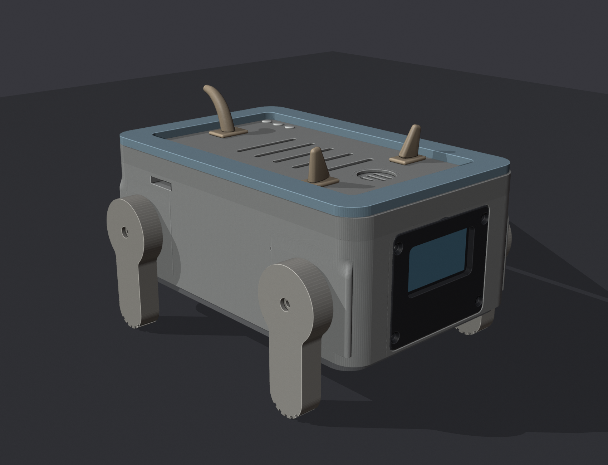
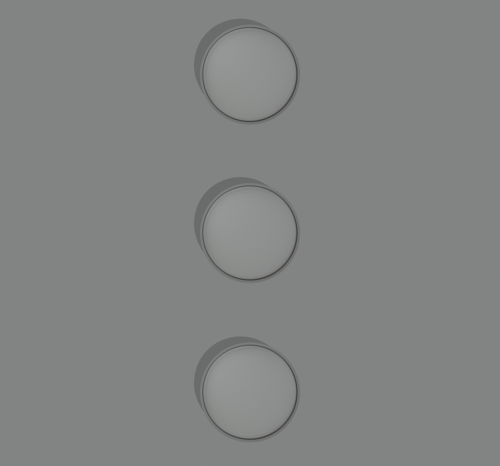
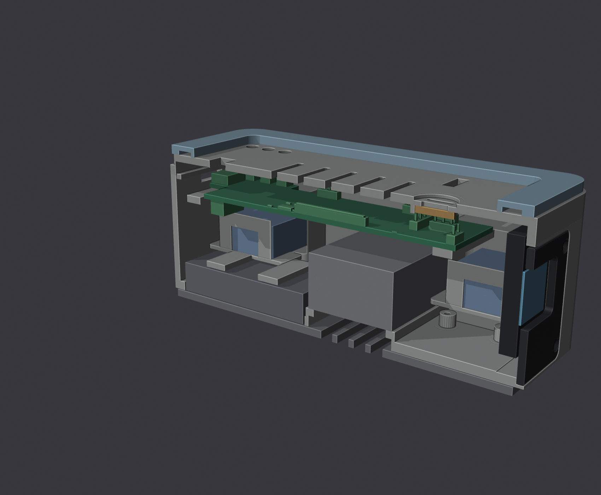

# ESP32 机器狗桌宠：3D 打印外壳设计

基于 Blender + BlenderMCP 的 ESP32 四足桌宠外壳工作区。当前版本 **v3（顶盖三键 · 触摸栅格 · 可拆狗耳/尾）** 在 v2 无头壳结构上增补交互与造型：3 个顶盖按钮正对 PCB 原开关，触摸大孔改为 Ø13 指窝 + 3 条触摸缝并加 C 形托环，顶盖前部压入 2 只镜像狗耳、后中压入 1 条上翘尾巴；耳/尾/按钮全部免螺钉可拆。四条腿仍直接套在舵机单臂舵盘上前后摆动，OLED 在机身内与 PCB 用 4-pin 线直连。

完整装配步骤、螺丝 BOM 与打印方向见 **[design/enclosure-v3-assembly.md](design/enclosure-v3-assembly.md)**。



## 本轮改动（2026-11-11 晚）

- **3 个顶盖按钮**替代原侧壁按键柱，中心 x=−24.83、y=−35.47/−42.45/−49.47，正对 PCB 同 3 个开关；帽顶高出顶盖 0.75，法兰与开关留 0.10；旧侧壁孔已填平。
- **触摸改栅格**：Ø13×1.0 浅指窝 + 3 条 1.2×8.2 缝（x=−3.2/0/+3.2），Ø11.8 模块下置，C 形托环承托，顶部间隙 0.02。
- **可拆狗耳 ×2**：单只 11.5×7.5×15.97，外倾 14°/后仰 6°，燕尾舌 9.4×3.6 压入 9.6×3.8 槽，单边 0.10；左右镜像。
- **可拆尾巴 ×1**：13×22.38×28.68，曲线管 Ø5.4→Ø3.1 + R1.55 球头；舌 10.2×6.4 压入 10.4×6.7 槽，X/Y 单边 0.10/0.15。
- 整机高度 70 → **92.40**（尾尖），耳尖 79.69；X/Y 包络 **96×128.05** 不变。
- 打印件 10 STL / 12 件 → **11 STL / 15 件**；紧固件仍为 **14 颗**（4×M2×6 平头 + 6×M2×8 圆头 + 4×M2×10 圆头）。

### 2026-11-12 修订

- **按钮触摸面改平滑**：4 瓣开槽帽 → 整体平滑球冠 Ø4.15；帽顶高出盖面 0.75，外露侧面/顶面连续无槽。
- **顶盖孔**：Ø4.2 通孔 + Ø4.9×0.3 浅座 → **Ø4.4 直通孔**，浅座填平齐平；帽与孔单边 0.125，按压 0.35 后由 PCB 开关本体限位。
- **防脱不变**：法兰 Ø5.6 > 孔 Ø4.4，外侧无法拔出；顶盖单独拿开时按钮由下方开关托住（装配见文档第 8 节）。
- **STL 全部 0 缺陷**：顶盖/机身按 BEAUTY 三角化后，11 个 STL 均为 0 非流形 / 0 边界 / 0 零面积（原机身 32、顶盖 31 个零面积面已消除）。
- 新增 42–48 内部结构图：按钮平滑面、顶盖背面、内部布局、半剖。

### 2026-11-12 装配复测与交付

- **顶盖唇边干涉修复**：机身内壁两个残留筋条与顶盖唇边重叠 **2.73 mm³**，布尔差集切除；修复后 14 对关键配合 EXACT 布尔交集全部为 **0**。
- **尾巴加长**：单条 **13×22.38×28.68**，尾尖 **z92.40**；尾管悬空段与圆球下方必须加树状支撑。
- **螺丝规格复测**：前脸 **4×M2×6 平头/沉头**（孔深 4.5，已是上限）、腹板 **6×M2×8 圆头/盘头**（有效旋合约 6.7）、腿 **4×M2×10 圆头**（约 3.6 入舵机轴），合计 14 颗。前脸滑牙勿换 M2×8。
- **打印方向修正**：顶盖必须**外顶面朝下（top-down）**；按钮必须 brim；尾管必须支撑。
- **交付图**：6 张中文箭头标注图（整机零件、壳体分解、顶盖内侧、内部布局、螺丝图、尾巴打印）与 `design/enclosure-v3-assembly.md`。




## 仓库内容

| 路径 | 说明 |
|---|---|
| `blender/robot_dog_enclosure_v3.blend` | **v3 完整装配**：11 STL / 15 件 + PCB + 器件占位 + 舵机/电池/喇叭/OLED/触摸检具；集合 `RobotDog_v3`，母件在 `Print_Masters` |
| `blender/_work/rev3_build.py` … `rev3_stl_audit.py` | v3 顶盖/侧壁改建、耳/尾/按钮建模、干涉验证、渲染、导出、STL 审计脚本 |
| `blender/_work/rev13_*.py` | 2026-11-12 平滑按钮重建、顶盖 Ø4.4 孔/填座、三角化、验证与内部结构渲染脚本 |
| `blender/v2lib.py` | 通用建模工具：圆角棱柱、布尔、干涉体积、非流形检查 |
| `blender/start_blender_mcp.cmd` | 一键启动 Blender GUI 并开启 BlenderMCP socket 服务 |
| `design/enclosure-v3.md` | **v3 设计文档**：按钮/触摸/耳/尾、配合与剖面、验证、打印方向、装配、风险 |
| `design/enclosure-v3-assembly.md` | **v3 装配指南**：11 STL / 15 件清单、螺丝 BOM、打印方向、逐步装配、拆卸、验证证据 |
| `design/enclosure-v2.md` | v2 基线：摆腿、前脸/屏窗、OLED 直连、端口、电池、腹板 |
| `design/enclosure-v3-*.png` | v3 预览与标注图（22 张）：整机、顶盖、按钮、触摸、双耳、尾、爆炸、剖面、内部结构、6 张箭头标注图 |
| `design/enclosure-v2-*.png` | v2 预览：整机、正面、开盖、内部分层、±20° 步态 |
| `blender/_review/` | **48 张细节审查图 + 70–83 标注底图**；30–48 为 v3（整机、顶盖、按钮、触摸、耳/尾、爆炸、剖面、内部结构） |
| `design/enclosure-spec.md` | 通用 FDM/ESP32 设计规范（壁厚、公差、天线、电池、导出） |
| `stl/v3/` | v3 全部 **11 个 STL（打印 15 件）**，1:1 mm |
| `stl/v2/` | v2 基线 STL，保留用于对比/回退 |
| `design/_archive_*.md`、`stl/v2/_archive_*`、`blender/_archive*/` | 旧版文档、头壳/轮式零件与旧 blend，仅存档 |
| `exports/` | v1 旧版底板/上盖 STL（不再对应当前结构） |
| `.qoder/skills/esp32-pet-enclosure/SKILL.md` | Qoder 项目 skill：建模、验证、导出流程 |

## 当前基线（v3）

**配件**

- 主板：53.98×99.64×1.6，水平置于 z54–55.6，板中心 y=−8，前缘 y41.82。
- 舵机：4× SG90 180°，四角侧舱，输出轴朝 ±X，**轴心 y=±44、z=38**，侧壁 Ø14 开口；本体 z31.9–44.1。
- 摆腿：8×24.98×50.48，单臂舵盘翻转朝下直连，8.4 宽 U 槽 + R4.2 轮毂窝 + 1×M2×10；±28° 机械摆角，建议 ±20°。
- 显示：1.3" SH1106 模块 35.4×33.5×5，装在机身前端 y56.2–61.2，**屏心 z45**；前脸正面 y64.05；4-pin 线跨 14.38 mm 直连 PCB。
- 电池：103450（10×34×50，PH2.0），腹部电池仓 z20.2–30.2。
- 声音：3070 腔体喇叭，z26–44，朝下，腹板 4 条栅格。
- 交互：顶盖 **3 个按钮**（x=−24.83；y=−35.47/−42.45/−49.47）+ **触摸栅格**（x0、y35）；无侧壁按键。
- 头部/尾部：顶盖 **2 只可拆耳**（x=±21、y=30）+ **1 条可拆尾**（x0、y=−43），均摩擦压配。

**整机**

| 部件 | 外形（X×Y×Z，mm） |
|---|---|
| 机身 | 78.04×128×40（z20–60，壁厚 2.4） |
| 顶盖 | 78×128×8.2（z58.8–67，1.2 定位唇，重力定位） |
| 前脸 | 46×2.2×38（z21–59，正面 y64.05，窗心 z45） |
| 摆腿 ×4 | 8×24.98×50.48（2 个 STL 各打 2 件） |
| 腹板 | 76×124×2.5（z17.2–19.7） |
| 导光环 | 79×126×3（z67–70） |
| 按钮 ×3 | 5.6×5.6×8.85（帽顶 z67.75） |
| 耳 ×2 | 11.5×7.5×15.97（耳尖 z79.69） |
| 尾 ×1 | 13×22.38×28.68（尾尖 z92.40） |
| 整机 | **96×128.05×92.40** |

**关键净空**

- 腿顶 50.48 / SD 槽下沿 55.9 → **5.42**；卡片最低 56.75 → **6.27**。
- OLED 玻璃 61.83 / 前脸背 61.85 → **0.02**；OLED 背 56.2 / PCB 前缘 41.82 → **14.38**。
- 腹板 17.2；±20° 摆腿脚底抬 1.83，±28° 抬 3.55。
- 按钮法兰 58.9 / PCB 开关 58.8 → **0.10**；帽顶高出顶盖 **0.75**，按压 **0.35**（开关全行程）后由开关本体限位。
- 触摸模块顶 64.58 / 盖内顶 64.6 → **0.02**；C 环单边径向 **0.2**，底部唇托 0.05。
- 耳 ↔ 灯环 **2.749 / 2.745**、耳 ↔ 触摸模块 **9.928**；尾 ↔ 灯环 **5.496**、尾 ↔ 机身 **11.041**。
- 前脸 ↔ OLED 有效区 **0.02**；腹板 ↔ 电池 **0.50**；顶盖唇边 ↔ 机身内壁（单边）**≈0.304**。
- 耳舌 9.4×3.6 / 槽 9.6×3.8 → **0.10/边**；尾舌 10.2×6.4 / 槽 10.4×6.7 → **X 0.10、Y 0.15/边**。

**开孔**

- USB-C：10.6×3.4，−Y 后壁，中心 x≈−17.2、z≈57.0；标准 8.4×2.6 插头 13 mm 插入 0 干涉。
- 电源开关：6.2×4.2，−Y 后壁，中心 x≈18.2、z≈57.2。
- microSD：12.8×2.7 导向槽，+X 右壁，中心 y=−32.5、z55.9–58.6。
- 顶盖按钮：Ø4.4 直通孔 ×3（旧 Ø4.9×0.3 浅座已填平齐平）；帽 Ø4.15，单边 0.125。
- 触摸：Ø13 指窝 + 3 条 1.2×8.2 缝；盖内 C 环 OD14.8 / ID12.2，+Y 8 mm 缺口。
- 耳槽 9.6×3.8、尾槽 10.4×6.7，均深 3.0。
- 散热：顶盖 5 条 28×2.2 槽；喇叭栅格开孔率约 13%。

**紧固件**：前脸 4×M2×6 平头/沉头（孔深 4.5，**已是上限**，滑牙勿换 M2×8）、腹板 6×M2×8 圆头/盘头（有效旋合约 6.7）、摆腿 4×M2×10 圆头（约 3.6 入舵机轴）。合计 **14 颗**；按钮/耳/尾/顶盖/灯环免螺钉。

## 验证结果

- **14 对关键配合 EXACT 布尔交集全部 0.0000 mm³**：顶盖×机身、前脸×机身、腹板×机身、灯环×顶盖、尾×顶盖、左右耳×顶盖、3 按钮×顶盖、触摸×顶盖、PCB×机身、电池×机身、喇叭×机身；此前 29 对快速干涉检查亦为 0 面重叠。
- **顶盖唇边干涉修复**：机身内壁两个残留筋条与顶盖唇边重叠 **2.73 mm³**，布尔差集切除后交集为 0；唇边单边间隙约 0.304。
- **11 个 STL / 15 件**全部为单一连通体，**非流形边 0、边界边 0、零面积面 0**（顶盖/机身在源文件内 BEAUTY 三角化；机身 46 624 面 / 76 556 mm³，顶盖 8 582 面）。
- 静态关键间距：按钮/PCB 元件 0.10；耳/灯环 2.749/2.745；尾/灯环 5.496；尾/机身 11.041；触摸/顶盖 0.02；前脸/OLED 0.02；腹板/电池 0.50。
- 剖面检查（39/48）：平滑帽 Ø4.15 在 Ø4.4 孔内单边 0.125、入孔 0.5，法兰留在盖内；耳舌/尾舌完整落入槽内，法兰贴盖，无穿帮。
- 摆腿 ±20°/±28°：4 条腿对机身、腹板 0 干涉；脚底最低 **1.83 / 3.55**（相对机身）；腿-腿 0 干涉。
- SD 插卡：15×11×1 卡在 3 个高度 × 3 个深度 0 干涉，可插到 x=24，不碰腿。
- USB-C 标准插头壳 13 mm 插入 0 干涉；开关拨柄 0 干涉。
- 整机包围盒 **96×128.05×92.40**；脚底 z0，腿顶 50.48，耳尖 79.69，尾尖 92.40。
- STL 按 `global_scale=1.0`、`use_scene_unit=False` 导出，包围盒与 CAD 一致。

## 细节渲染（blender/_review）

| 编号 | 内容 |
|---|---|
| 01–06 | 整机 3/4、正面、右侧、后 3/4、低机位、无前脸正面 |
| 07–08 | 前脸正面/3/4，高位屏窗与 4 颗沉头螺钉 |
| 09–14 | 腿外侧、内侧带舵盘、内侧裸槽、腿底、圆头防滑槽、SD 与腿净空 |
| 15–18 | ±20°/±28° 步态，3/4 与侧视 |
| 19–22 | 腿/舵盘剖切、开盖、隐藏外壳内部、四舵机+腿布局 |
| 23–25 | 顶盖、后低机位（USB/开关/SD）、腹部（6 螺钉+喇叭槽） |
| 26–29 | 左侧壁、后端口特写、前脸螺钉特写、SD 槽特写 |
| 30–31 | **v3 整机 3/4、正上方顶盖** |
| 32–33 | **顶盖三按钮、触摸指窝+三缝** |
| 34–36 | **正面双耳、尾巴 3/4、尾/灯环侧视** |
| 37–38 | **顶盖背面（按钮法兰/C 环/槽）、爆炸图** |
| 39–41 | **按钮剖面、耳剖面、尾/灯环剖面** |
| 42–44 | **平滑按钮顶视/3/4、顶盖背面按钮法兰** |
| 45–46 | **内部器件 3/4、内部俯视布局** |
| 47–48 | **半剖内部结构、按钮剖面 3/4** |
| 70–83 | **2026-11-12 标注底图**：整机零件、爆炸壳、顶盖内侧、内部布局、螺丝三视图、尾巴打印 |

`zz_*.png` 是测量/诊断图，不对外。设计预览图已同步为 30/31/32/33/34/35/38/39/40/41/42/44/45/46/47/48。

## 快速开始

1. 安装 BlenderMCP 插件：

   ```bash
   uvx mcp-for-blender install-addon
   ```

2. 启动 Blender 和 MCP 服务：

   ```bat
   blender\start_blender_mcp.cmd
   ```

   也可正常打开 Blender，按 `N` → `MCP for Blender` → `Connect to Claude`，服务监听 `127.0.0.1:9876`。

3. 打开 `blender/robot_dog_enclosure_v3.blend` 查看装配；打印件在 `RobotDog_v3` 集合，母件在 `Print_Masters`，检具在 `Fit_Check`。

4. 切片：直接导入 `stl/v3/` 对应 STL。打印方向、支撑/brim 与装配顺序见 `design/enclosure-v3-assembly.md`；耳/尾/按钮先打单件试槽。

## 环境要求

- Blender 5.x（本项目在 Blender 5.4 Alpha 上验证）。
- [uv](https://docs.astral.sh/uv/)（`uvx` 启动 BlenderMCP 服务端）。
- BlenderMCP 插件 1.8+ / 服务端 1.30+（协议 v15）。
- Windows、Qoder Desktop（可选，用于通过 MCP 驱动 Blender）。

## 单位与导出

- 约定：**1 Blender 单位 = 1 mm**；Metric，`scale_length=0.001`，`length_unit=MILLIMETERS`。
- STL 导出：`use_scene_unit=False`、`global_scale=1.0`。
- 导出后必须复核 STL 包围盒，不要只信 `obj.dimensions`。

## 已知限制

- **耳/尾/按钮是摩擦/卡装，不是锁扣**：桌面展示没问题，倒置或甩动可能掉件；儿童/宠物环境建议加 0.1 mm 胶带、TPU 95A 或小螺钉。搬整机不要拎耳/尾/按钮。
- **顶盖是重力定位，不是摩擦锁扣**：内唇单边约 0.30、外缘仅约 0.2 搭接，靠自重 + 导光环压住；搬动托底，只抓顶盖会脱开。需要搬运固定时在止口贴 1 圈 0.2 mm 美纹胶或加 2 颗 M2 侧向螺钉。
- **FDM 孔会缩**：0.10 单边配合可能变过盈；首件先打 1 只耳 + 尾试槽，过紧砂纸修舌侧，过松贴胶带，不要修槽到松垮。
- **按钮防脱/装配**：法兰 Ø5.6 > Ø4.4 孔，装好后无法从外侧拔出；顶盖单独拿开时按钮由下方开关托住，翻面可能向内掉落，按设计文档第 8 节顺序装配即可。
- **触摸模块批次**：按 Ø11.8×1.98 设计，径向仅 0.2、顶部仅 0.02；来料偏大/偏厚会塞不进或顶盖，首件干装确认。
- **尾管必须加支撑**：悬臂 + Ø3.1 球头，支撑点会留痕；不要用尾管当提手。
- **摆腿是绕髋轴划弧，不是直线平移**：单自由度适合踏步/摇摆步态，建议 ±20°，先 ±15° 低频试走。
- 单臂舵盘批次差异大：腿 U 槽按 8.4 宽、R4.2 轮毂窝、18 长臂设计；臂长 >18 需剪短，厚 >2.5 锉薄。
- 四条腿共用网格，装配前必须标定舵机中位，否则静止姿态会歪。
- 主板依靠泡棉双面胶 + 顶盖限位，无螺钉；频繁拆装建议加打印压脚。
- **OLED 无螺钉**：靠屏仓 + 四点胶，前脸背面作前限位（0.02）；不要加泡棉；排线仅 14.4 mm，建议薄排线/弯头插座。
- 前脸外凸仅 0.05，首层压边会影响齐平度；打印后先修边再压入。
- USB/开关开口靠近顶盖上沿；带大台阶/磁吸转接头的线可能蹭裙边，首件试插。
- 旧侧键孔已填平，外壁连续；若打印后看到轻微环印，砂纸/补土处理，不影响强度。
- **前脸螺丝长度上限**：M2×6 已接近 Ø1.7×4.5 孔底；头顶不到底时锉短尖端 0.3 mm 或换 M2×5，滑牙改 M2.2 或点胶，切勿用 M2×8。
- 高度增至 92.40（尾尖），确认展示架/包装高度。
- 未做付费打样、充电温升、跌落和儿童安全验证；PETG 更适合最终件，PLA 仅用于试装。

## 下一步

1. 复核来料触摸模块、SG90 舵盘、OLED 模块与 103450 电池，偏差回填 `design/enclosure-v3.md` 与模型。
2. 打印首件（1 只耳 + 尾 + 3 按钮 + 顶盖）试压配，确认 0.10/0.15 间隙与平滑帽按压/回弹手感。
3. 打印机身/腿/前脸/腹板，试装舵机、舵盘、主板与 OLED；标定四路舵机中位。
4. 验证 ±20° 步态、四脚着地与整机重心；确认耳/尾在行走震动下不松脱。
5. 需要量产时把 v3 交互模型整理成参数化脚本；外观件可直接在顶盖/机身增加，不影响当前结构。
