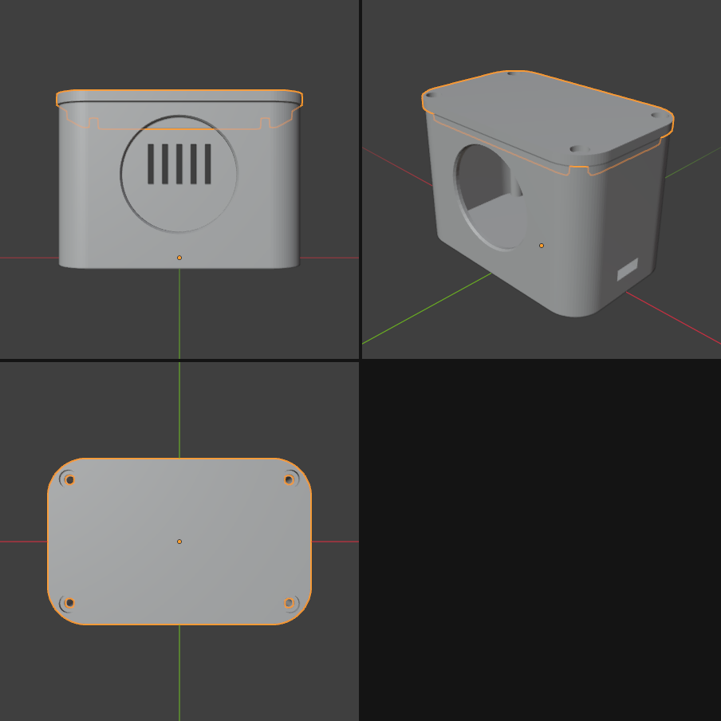

# ESP32 智能桌宠：3D 打印外壳设计

基于 Blender + BlenderMCP 的 ESP32 桌面宠物外壳工作区。当前包含一套参数化两件式外壳基线、设计规范、BlenderMCP 启动脚本和可直接查看的 STL 预览。



## 仓库内容

| 路径 | 说明 |
|---|---|
| `blender/esp32_pet_enclosure.py` | 参数化生成底板和上盖；屏幕窗、USB、散热槽、扬声器孔、M2.5 螺柱、上盖止口 |
| `blender/start_blender_mcp.cmd` | 一键启动 Blender GUI 并开启 BlenderMCP socket 服务 |
| `blender/start_mcp.py` | Blender 启动脚本：启用插件并启动服务 |
| `design/enclosure-spec.md` | 硬件测量清单、FDM 公差、ESP32 天线/散热/电池规则、Blender 单位与 STL 导出规范 |
| `design/enclosure-preview.png` | 当前外壳的正面/三视角/顶视图预览 |
| `exports/enclosure_base.stl` | 底板 STL（毫米） |
| `exports/enclosure_lid.stl` | 上盖 STL（毫米） |
| `.qoder/skills/esp32-pet-enclosure/SKILL.md` | Qoder 项目 skill，描述完整建模、验证和导出流程 |

## 当前基线

- 占位硬件：ESP32 DevKitC V4（54.4×27.9×12 mm）+ 1.28 英寸圆形显示屏。
- 整机外形：70.4×43.9×49.3 mm；内腔 66.4×39.9 mm。
- 屏幕窗口：Ø32 mm，外侧 0.8 mm 倒角。
- USB 开孔：9.4×3.6 mm，位于 +X 端。
- 后壁 5 条散热槽；侧壁 5×Ø2.2 mm 扬声器孔。
- 四角 M2.5 自攻螺柱，上盖 M2.5 过孔 + 沉头孔。
- 实测：底板 70.4×43.9×46.0 mm，上盖 71.6×45.1×7.0 mm；两个网格均为 0 非流形边、0 边界边。

这是可打印的**参数化基线**，不是特定硬件的最终装配件。主板固定、屏框、电池仓、舵机和外观造型仍需按实测硬件补齐。

## 环境要求

- Blender 5.x（本项目在 Blender 5.4 Alpha 上验证）。
- [uv](https://docs.astral.sh/uv/)（`uvx` 用于启动 BlenderMCP 服务端）。
- BlenderMCP 插件 1.8+ / 服务端 1.30+（协议 v15）。
- Windows、Qoder Desktop（可选，用于通过 MCP 驱动 Blender）。

## 快速开始

1. 安装 BlenderMCP 插件：

   ```bash
   uvx mcp-for-blender install-addon
   ```

2. 启动 Blender 和 MCP 服务：

   ```bat
   blender\start_blender_mcp.cmd
   ```

   也可以正常打开 Blender，按 `N` → `MCP for Blender` → `Connect to Claude`，服务监听 `127.0.0.1:9876`。

3. 在 Blender 中生成外壳：

   ```python
   import os
   os.chdir(r"<仓库目录>")
   exec(open(r"blender\esp32_pet_enclosure.py", encoding="utf-8").read(), globals())
   ```

   或通过 BlenderMCP 的 `execute_blender_code` 执行相同代码。脚本会保留其他场景对象，只清理自己的 `ESP32_Pet_Enclosure` 集合。

4. 自定义硬件参数：

   ```python
   SKIP_AUTO_BUILD = True
   exec(open(r"blender\esp32_pet_enclosure.py", encoding="utf-8").read(), globals())
   build({"board_l": 63.0, "board_w": 25.5, "display_d": 27.0})
   ```

   所有尺寸单位为毫米。生成后会在 `exports/` 写出底板和上盖 STL。

## 单位与导出

- Blender 约定：**1 Blender 单位 = 1 mm**。
- 场景单位显示：Metric，`scale_length=0.001`，`length_unit=MILLIMETERS`。
- STL 导出：`use_scene_unit=False`、`global_scale=1.0`。
- 导出后检查 STL 包围盒；不要只依赖 Blender 的 `obj.dimensions`。

## 已知限制

- BlenderMCP 插件不能运行在 `blender -b` 后台模式，必须使用 GUI。
- 同一时间只运行一个监听 9876 端口的 Blender 实例。
- 当前模型未包含主板固定、显示屏压框、电池仓、充电板、舵机和外观曲面。
- 打印前需按实际打印机/材料做首件试装；PLA 适合验证，PETG 更适合最终件。

## 待补硬件数据

1. ESP32 板型、实测长宽高（含排针）、USB 位置与高度、天线端。
2. 显示屏外形/有效区/厚度/排线方向。
3. 供电方案、扬声器/麦克风、舵机及运动范围。
4. 打印机喷嘴/材料、整机目标尺寸与造型风格。
