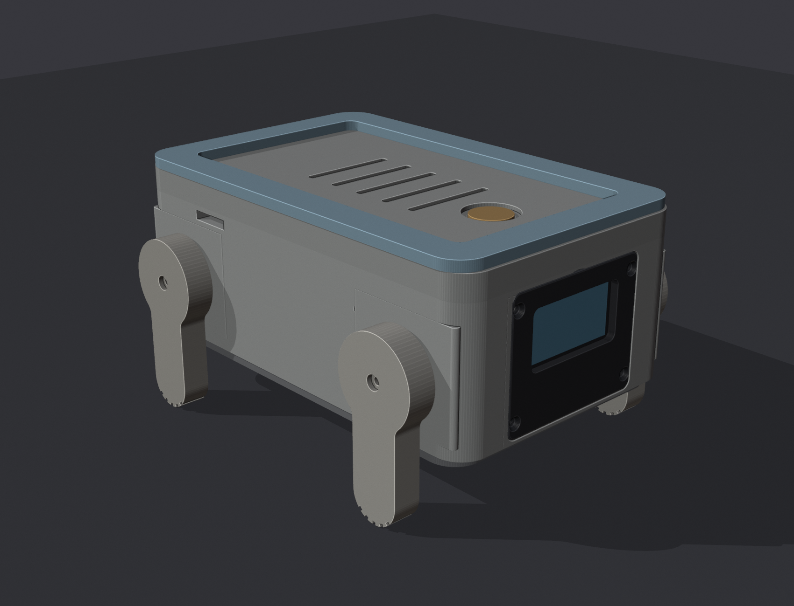

# 机器狗桌宠外壳 v2（无头壳 · 前脸嵌入身体 · OLED 直连 PCB）

更新：2026-11-11  
依据：`机器狗清单.xlsx`、购物截图、参考实拍图、`机器狗原理图PCB.eprj2` 板框与器件坐标。  
单位：mm。Blender 内 1 BU = 1 mm，STL 按 1:1 导出。

## 0. 本次修订

| 项目 | 上一版（独立头壳） | 本版（无头壳） |
|---|---|---|
| 头部 | 独立白色头壳 52 × 32 × 46，2×M3 固定 | **整个删除**，不留头壳、过线孔和 M3 |
| 显示 | OLED 装在头内，排线经 Ø14 过线孔回机身 | **OLED 模块直接装在机身前端内腔，4-pin 排线直连主板前缘** |
| 前脸 | 嵌入头壳前壁（正面 y=96.05） | **嵌入身体前端长方形**（正面 y=64.05） |
| 触摸 | 头顶 Ø12 触摸孔 | **顶盖顶面 Ø12 触摸孔**（x=0、y=35） |
| 整机 | 约 95.6 × 160.05 × 72 | **95.6 × 128.05 × 64** |
| 打印件 | 11 个 STL / 14 件 | **10 个 STL / 12 件** |
| 紧固件 | M2×14 + M3×2 | **M2×14** |

这版把“头”真正并进身体：屏幕、主板、舵机、电池、喇叭全部在同一个 78 × 128 × 40 的机身内，前脸只做一块 2.2 厚的嵌入面板，OLED 背面到主板前缘只有 14.4 mm，直接用 4-pin 线跨接。

## 1. 配件与设计取值

| # | 配件 | 设计取值 | 在外壳中的位置 / 做法 |
|---|---|---|---|
| 1 | PCBA 主板 | 板框 53.98 × 99.64 × 1.6；上表面器件最高约 4.8，下表面约 5.0 | 水平放在 z=48.0 的支承面；板中心 y=-8；前缘 y=41.82，正对 OLED 背面 |
| 2 | SG90 180° 舵机 ×4 | 机身 22.8 × 12.2 × 22.5，输出轴 Ø5，**单臂舵盘** | 四角侧舱，轴朝 ±X，**轴心 y=±44、z=34**；轴上直接套摆腿，1×M2 中心螺钉 |
| 3 | 1.3" SH1106 OLED | 模块 35.4 × 33.5 × 5.0；有效区 29.42 × 14.70；视窗 31.4 × 16.7 | **装在机身前端内腔** y=56.2–61.2，屏心 z=34；4-pin 直连主板，不经过任何头壳或转接板 |
| 4 | 103450 锂电池 | 10 × 34 × 50，PH2.0 | 腹部电池仓，z=14.2–24.2；底部腹板承托，双压带 |
| 5 | 3070 腔体喇叭 | 30 × 70 × 18（按 18 厚保守取值） | 腹部中央，z=20–38，朝下出音；腹板开 4 条栅格 |
| 6 | 灯带 + 触摸按键 | 5 mm COB 灯带；Ø12 触摸模块 | 顶盖四周磨砂导光环；**顶盖顶面 Ø12 触摸孔**（x=0、y=35） |
| 7 | micro SD | 15 × 11 × 1 | 主板 +X 侧，12.8 × 2.7 导向槽接出侧壁 |
| 8 | 3D 打印外壳 | 本设计，独立建模 | 机身 + 顶盖 + **前脸** + 摆腿（2 个 STL，各打印 2 件）+ 腹板 + 导光环 + 按键柱 ×3，共 **10 个 STL / 12 件** |

> 厂商外壳文件未开源。本设计仅依据公开配件尺寸与实拍照片的机械/造型线索独立完成，未复制厂商文件。

## 2. 整机尺寸

| 部件 | 外形（X × Y × Z） | 说明 |
|---|---|---|
| 机身 | 78.04 × 128 × 40（z 14–54） | 壁厚 2.4，底厚 3；四角 R8；前端加厚出屏框 |
| 顶盖 | 78 × 128 × 8.2（z 52.8–61） | 1.2 高止口；摩擦配合，指槽在 −Y 端 |
| 前脸 | 46 × 2.2 × 38（z 15–53） | 正面 y=64.05，比机身前面 y=64.00 只高 0.05；窗 31.4 × 16.7 |
| 摆腿 ×4 | 7.8 × 26 × 54 | 单臂舵盘直连；髋部宽 24，盖住机身 Ø14 侧开口 |
| 腹板 | 76 × 124 × 2.5（z 11.2–13.7） | 6×M2 固定，喇叭栅格 + 电池承托 |
| 导光环 | 79 × 126 × 3（z 61–64） | 半透磨砂，5 mm 灯带槽 |
| 整机 | **95.6 × 128.05 × 64** | 含摆腿、前脸、导光环；脚底 z≈0（中位最低点 0.001） |

四条腿的脚底弧面以髋轴为圆心 R34，±28° 摆动时最低点仅抬升 1.07 mm，近似贴地划弧。

## 3. 结构要点

### 3.1 摆腿与舵机

- 每个角一个实心舱体，向内开舵机槽；**输出轴从机身侧壁 Ø14 开口伸出，轴心 y=±44、z=34**。
- 腿主体 7.0 厚（脚掌 7.8），髋部最宽 24；内侧开 **Ø8.3 × 3.6 舵盘中心让位 + 6.8 宽 × 3.0 深 × 18 长臂槽（自轴心朝上）**，轴心 Ø2.2 过孔 + 外侧 Ø4.2 × 1.2 沉台。
- 装配：舵机装入舱 → 单臂舵盘压到输出轴 → 腿套上舵盘并对准中心让位与向上臂槽 → **1×M2×10 从腿外侧中心孔拧入舵盘**。整条腿只靠这一颗螺钉，拆装 10 秒。
- 髋部 24 宽 > 侧壁 Ø14 开口，任意摆角下都能遮住内部舵机与走线，所以不需要侧板也不露缝。
- 摆角 ±28°（对应舵机 56° 行程）。实测脚底最低点：−28° 为 0.070、0° 为 0.001、+28° 为 1.067，全程不穿地。
- 腿最大宽 26（髋部 24），主体厚 7.0、脚掌 7.8，形成“片状腿”观感；脚尖外扩到 26 宽以增加侧向稳定。
- 前后腿共用网格数据，左右镜像；`Leg_L/Leg_R` 为前腿（y 32–58），`Leg_L_Rear/Leg_R_Rear` 为后腿（y −56–−30）。

### 3.2 前脸嵌入身体前端

- 机身前面在 x±24.6、z14–52.6 范围内加厚成屏框；前端开 **46.4 × 38.4、R2.6、深 2.2** 的嵌槽，单边留 0.2 装配间隙。
- 前脸 46 × 2.2 × 38 从前方压入，正面 y=64.05，比机身外观面 y=64.00 **只高 0.05**，肉眼即齐平；侧向和上下由嵌槽壁限位，不靠外观面找正。
- 屏窗 31.4 × 16.7，对应 OLED 有效区 29.42 × 14.7（屏心 z=34），四周各留约 1 mm 遮挡。
- 屏隧 36.4 × 34.4、R0.8，深 5.3（y=56.5–61.8）；OLED 模块 35.4 × 33.5 从机腔内向前穿入，单边约 0.5 间隙。
- 前脸背面与 OLED 玻璃面之间设计间隙 **0.02**：前脸是模块的前限位。模块没有螺钉，靠屏隧配合 + 四边点少量中性硅胶/贴 0.1 mm 胶带定心；**不要在前脸与屏之间加泡棉**，否则前脸压不进 2.2 深嵌槽。
- 前脸 4×M2×6 自攻，孔位 **x=±20.8、z=19.5 / 48.5**，落在屏窗与面板外缘之间的实心边框上；前脸正面做沉头，机身预钻 Ø1.9 × 4.2 深盲孔，孔底留约 1.1 mm 壁。拧到贴合即停，勿过拧。

### 3.3 OLED 与主板直连

- OLED 模块外形 35.4 × 33.5 × 5.0，位于机身前端 y=56.2–61.2、z=17.25–50.75；有效区朝前，玻璃面 y=61.23–61.83。
- 模块背面 4-pin 排针朝机腔内；主板前缘 y=41.82，**两者水平间距 14.38 mm**，用 4-pin 母对母杜邦线或 4P FFC 转接直连，不经过任何中间壳、转接板或头部过线孔。
- 走线从模块背面下沿（z≈20–26）出，沿机身前端内壁向下再折向主板前端，避开前脸螺钉盲孔（z=19.5 一排）和屏隧下壁；建议用 0.8 mm 薄排线，弯折半径 ≥3 mm。
- 屏幕、主板、电池、喇叭、四路舵机全部在同一机身内腔，开盖即可检修；拔插 OLED 线不需要拆前脸。
- 装配前先干插模块，从前窗检查有效区是否被窗框均匀遮挡；再点胶固定，最后装前脸。

### 3.4 主板与端口

- 主板 z=48.0–49.6，由四角舵机舱顶面 + 两道横梁支承；板中心 y=-8。
- 主板无固定螺钉；建议四角贴 1–2 mm 泡棉双面胶，顶盖内顶与器件顶仍有约 5.3 mm 间隙。
- USB-C：−Y 端壁，开口 10.6 × 3.4，中心 x=-17.2、z=50.5。
- 电源开关：−Y 端壁，开口 6.2 × 4.2，中心 x=18.2。
- micro SD：+X 端壁，12.8 × 2.7 导向槽，中心 y=-32.5、z=50.5。
- 三个贴片按键：−X 端壁，Ø3.4 孔 ×3（y=-35.5 / -42.5 / -49.4，z=51.2），配 12.05 mm 打印按键柱。
- 主板前端不再有头部过线孔；OLED 4-pin 线直接从前缘 y=41.82 接入。

### 3.5 电池与喇叭

- 电池仓 y=-59.5…-8.5，宽 35.4；电池 34 × 50 四周留 0.7–0.8；顶面两条 8 mm 压带防跳。
- 电池由腹板承托；拆下腹板 6 颗 M2 即可换电池。建议电池与腹板之间加 1 mm 泡棉。
- 喇叭舱 70 × 30，z=20–38，朝下；腹板对应 4 条 62 × 4.2 出音槽，开孔率约 13%。
- 喇叭顶部 z=38 与主板下器件 z=43 之间留约 5 mm 走线空间。

### 3.6 顶盖、导光环与触摸按键

- 顶盖 78 × 128 × 8.2，1.2 高止口摩擦配合，−Y 指槽可起盖。
- 导光环 79 × 126 × 3，底面 5.2 × 1.4 环槽贴 5 mm COB；出线从顶盖 −Y 缺口进入机腔。
- 顶盖本体开 5 条 28 × 2.2 散热槽，位于导光环内圈以内（y=20 / 10 / 0 / −10 / −20）。
- 触摸孔移到顶盖：**x=0、y=35，Ø12 通孔 + Ø15.5 × 1.2 沉台**；孔位在导光环内圈以内、散热槽之外。
- Ø12 触摸模块从内侧装入，顶面低于顶盖外观面约 0.4，四周由 Ø15.5 沉台遮缝；用双面胶或点胶固定，感应面不要被胶覆盖。

## 4. 装配顺序

1. 四个 SG90 从机腔内装入四角舱，输出轴穿出侧壁 Ø14 开口。
2. 单臂舵盘压到输出轴（注意舵盘方向与摆腿行程一致）。
3. 腿套上舵盘、对准 Ø8.3 中心让位与 6.8 宽臂槽（臂朝上），1×M2×10 从腿外侧中心孔拧入舵盘；手动摆 ±28° 检查不刮机身。
4. OLED 模块从机腔内向前穿入屏隧，从前窗检查居中，四边点胶/贴胶带定心；固化后再装前脸。
5. 前脸从前方压入嵌槽，4×M2×6 对角拧紧；正面与机身齐平，窗内不应看到模块边框。
6. 喇叭粘密封圈放入腹部舱，导线从 +Y 侧开口引出；电池放入电池仓，接 PH2.0，压下两条压带。
7. 腹板从底部盖上，6×M2×6 固定；三个按键柱从 −X 外侧插入 Ø3.4 孔。
8. 主板放到 z=48 支承面，四角贴泡棉胶；接 OLED 4-pin、USB/SD/电池/喇叭/四路舵机线。
9. 触摸模块装入顶盖内侧 Ø12 孔，导光环灯带贴好后粘到顶盖。
10. 顶盖对准止口压下；开盖检查 OLED 排线没有被顶盖或主板夹住。

舵机中位必须在装腿前标定，否则四条腿的 0° 不共面。

## 5. 打印清单

`stl/v2/` 共 **10 个 STL / 12 件**（均 0 退化三角形、0 非流形边，1:1 mm）：

| 文件 | 数量 | 建议材料 / 颜色 | 说明 |
|---|---|---|---|
| Enclosure_Body.stl | 1 | 白色 PETG | 开口朝上，四角舵机舱与 SD 导向槽加树状支撑 |
| Enclosure_Lid.stl | 1 | 白色 PETG | 顶面朝上；触摸孔与导光环另件 |
| Face_Plate.stl | 1 | 深灰 PLA/PETG | 平放，正面朝上；窗内加支撑后修平 |
| Leg_L.stl | 2 | 蓝色 PETG/PLA | 侧放，舵盘让位槽朝上，加 brim；前左、后左共用 |
| Leg_R.stl | 2 | 蓝色 PETG/PLA | 侧放，舵盘让位槽朝上，加 brim；前右、后右共用 |
| Belly_Pan.stl | 1 | 白色 PETG | 平放 |
| LED_Diffuser_Ring.stl | 1 | 半透磨砂 PETG | 平放 |
| Button_Plunger_1/2/3.stl | 各 1 | 白色 PLA | 竖放 |

打印参数起点：0.4 mm 喷嘴、0.2 mm 层高、4 圈壁、5 层顶/底、20–30% 填充。首件务必试装后再批量。

紧固件：

| 规格 | 数量 | 用途 |
|---|---|---|
| M2×10 自攻 | 4 | 摆腿 / 单臂舵盘（每腿 1） |
| M2×6 自攻 | 10 | 前脸 4 + 腹板 6 |

合计 **M2×14**，不再使用 M3。

## 6. 验证结果

- 10 个 STL / 12 件全部为单一连通体，**0 退化三角形、0 非流形边**。
- 静态干涉 0 mm³：前脸/机身、OLED/机身、有效区/机身、OLED/前脸、有效区/前脸、OLED/主板、OLED/器件、前脸/顶盖、机身/顶盖、机身/主板、4×舵机/机身、电池/机身、喇叭/机身、电池/喇叭、触摸模块/顶盖、触摸模块/主板器件、导光环/顶盖、腹板/机身、腹板/四腿、3×按键柱/机身与顶盖。
- 摆腿 −28°/0°/+28°：腿/机身、腿/顶盖、腿/舵机壳、腿/舵盘、腿/腿全部 0 mm³。
- 脚底最低点：−28° = 0.070、0° = 0.001、+28° = 1.067，无穿地。
- 整机包围盒 **95.600 × 128.050 × 63.999**；脚底最低点 z=0.001（中位）。
- 前脸正面 y=64.05，机身前面 y=64.00，外凸 0.05；OLED 玻璃面 y=61.83，前脸背面 y=61.85，间隙 0.02。
- OLED 背面 y=56.20 到主板前缘 y=41.82，间距 **14.38**。
- 触摸孔：Ø12 通孔（r=6.0，z=58.6–61），Ø15.5×1.2 沉台（r=7.75，z=59.8–61）。
- STL 包围盒：机身 78.04 × 128 × 40；顶盖 78 × 128 × 8.2；前脸 46 × 2.2 × 38；腹板 76 × 124 × 2.5；导光环 79 × 126 × 3；摆腿 7.8 × 26 × 54；按键柱 12.05 × 4.8 × 4.8。

## 7. 待确认 / 风险

1. **电池型号冲突**：Excel 写 103450（10 × 34 × 50），购物截图为 10950-2000mAh。本版按 103450 设计；若实物为 10 × 95 × 50，电池仓与整机长度需重做。打印前请量实物。
2. **单臂舵盘批次差异**：不同 SG90 的舵盘臂宽、厚度、臂长不一致。本版让位 Ø8.3 × 3.6、臂槽 6.8 宽 × 3.0 深 × 18 长（自轴心朝上），臂长超过 18 mm 需剪短。首件先拿实物舵盘试插；M2×10 若顶到输出轴底部导致腿未压紧，改用 M2×8 或加垫片。
3. **舵机中位一致性**：四条腿共用同一网格，若某个舵机中位偏 2–3°，腿的静止姿态会歪。建议软件里先回中再装腿。
4. **摆腿是划弧不是直线行走**：±28° 摆动配合脚底 R34 弧面，单腿近似原地踏步/划弧。若要做真正的前后位移，需要额外增加髋部平移自由度或改成两段腿；本版按“舵机连接杆直连、前后摆动”实现。
5. **OLED 是无螺钉压紧**：模块只靠屏隧 0.5 单边配合 + 四边点胶定心，前脸背面作前限位（间隙 0.02）。点胶前必须从前窗确认居中；不要加泡棉，否则前脸压不平。不同批次模块厚度/排针位置可能不同，首件先干插。
6. **OLED 排线很短**：模块背面到主板前缘只有 14.4 mm，4-pin 插头/杜邦头会占去 8–10 mm。建议用薄排线或弯头插座；装顶盖前确认线没有被夹在主板与顶盖之间。
7. **前脸边框较窄**：M2 沉头孔位 x=±20.8，距面板外缘约 2.2 mm；打印时该处易缺料，首件请检查沉孔是否破边，拧螺钉不要过力。
8. 主板没有螺钉固定，依靠泡棉胶与顶盖限位；频繁拆装建议加打印压脚。
9. **触摸模块厚度/直径批次差异**：孔按 Ø12、沉台 Ø15.5×1.2 设计；实物偏大需铰孔，偏厚会顶到顶盖内壁，首件先试装。
10. 厂商外壳未开源，本设计为独立结构，外观细节与厂商件不同。
11. 天线位于主板 ESP32 模组一端（U2），不要把电池/金属件贴在模组天线正上方。
12. 充电与发热未做实测；建议 5 V 小电流充电并监测电池温度。
13. 前脸外凸只有 0.05，首层压边（elephant foot）会让它凸出或凹陷；打印后先修边再压入。

## 8. 源文件

- `blender/robot_dog_enclosure_v2.blend`：无头壳完整装配、PCB、器件占位、4 个舵机/电池/喇叭/OLED/触摸检具、4 条摆腿。
- `blender/v2lib.py`：建模工具函数（圆角棱柱、布尔、干涉体积、非流形检查）。
- `blender/preview_v2_assembly.png`：整机主视图。
- `blender/preview_v2_open.png`：开盖电子仓（含前端 OLED）。
- `blender/preview_v2_layers.png`：隐藏机身/前脸/顶盖的内部布局。
- `blender/preview_v2_face.png`：前脸嵌入身体特写。
- `blender/preview_v2_walk.png`：四腿 ±28° 小跑步态。
- `blender/_archive_head/robot_dog_enclosure_v2_with_head.blend`：删除头壳前的备份。
- `stl/v2/_archive_head/Head_Shell.stl`：旧头壳 STL，仅存档，不再使用。
