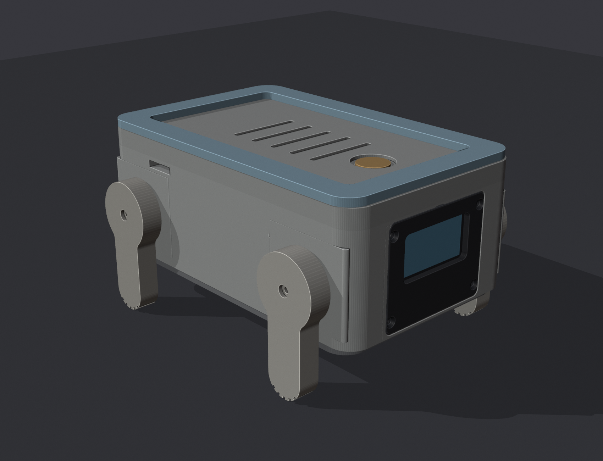

# 机器狗桌宠外壳 v2（无头壳 · 前脸嵌入身体 · OLED 直连 PCB · 圆底摆腿）

更新：2026-11-11（晚）  
基础：`blender/robot_dog_enclosure_v2.blend`（与 `blender/_work/stage3.blend` 同一文件，MD5 一致）  
渲染：`blender/_review/` 共 29 张细节图；旧版渲染在 `blender/_archive_review/`

## 0. 本次修订（2026-11-11 晚）

| 项目 | 上一版 | 当前版 |
|---|---|---|
| 腿 | 腿板 + 横向脚掌块，总高 54，脚底 R34 弧 | **一体式圆底摆腿**，8×25×50.5，底部 R7.5 圆弧，5 道防滑槽；删除脚掌块 |
| 腿孔 | 上半部分 3 个孔（用户图示） | **只保留中心轴孔** Ø2.2，外侧 Ø4.2 沉孔；其余孔全部删除 |
| 腿/舵机轴 | z40 | **z38**，相对机身下调 2 mm；腿顶 50.48 |
| 机身 | z14–54 | **z20–60**，整体 +6；腹板 17.2–19.7，离地 **17.2 mm** |
| 屏窗 | 窗心 z34，前脸中部 | **窗心 z45**，前脸上部；OLED 与窗随前脸 +11 |
| SD 卡 | 腿与卡槽同高，需要拆腿 | 腿顶 50.48 < 槽下沿 55.9，**插卡净空 5.4 mm**，不拆腿 |
| 顶盖 | z52.8–61 / 环 61–64 | **z58.8–67 / 环 67–70**，整机高 70 |
| 整机 | 96×128×64 | **96×128×70**（脚底 0，环顶 70） |
| 打印件 | 10 STL / 12 件 | 不变（左右腿各 1 STL，各打 2 条） |

从这一版起，旧腿的两个上孔、旧脚掌块、旧前脸位置都不再使用；旧文件已归档到 `blender/_archive/` 和 `blender/_archive_review/`。

## 1. 配件与设计取值

| # | 配件 | 设计取值 | 在外壳中的位置 / 做法 |
|---|---|---|---|
| 1 | ESP32-S3 DevKitC-1 | 53.98×99.64×1.6，器件最高 4.8（上）/5.0（下） | x±26.99，y−57.82…41.82，z54…55.6；四角筋位+泡棉，板中心 y=−8 |
| 2 | SG90 / MG90S 9g 舵机 ×4 | 本体 22.8×12.2×22.5，输出轴 Ø5，单臂舵盘 | 四角侧舱，轴朝 ±X，**轴心 y=±44、z=38**；本体 y32.6…55.4，z31.9…44.1 |
| 3 | 1.3" SH1106 OLED（0.96" 同接口可换） | 模块 35.4×33.5×5.0；有效区 29.42×14.70 | 机身前端内腔 y56.2…61.2，**屏心 z45**；4-pin 直连主板前缘 |
| 4 | 103450 锂电池（已确认） | 10×34×50，PH2.0 | 电池仓 y−59.5…−8.5，z20.2…30.2；腹板承托 + 双压带 |
| 5 | 3070 腔体喇叭 | 30×70×18（按 18 厚） | 腹部中央 y−7…23，z26…44，朝下出音 |
| 6 | 导光环 + 触摸模块 | 环 79×126×3；Ø12 触摸模块 | 环 z67…70；**顶盖顶面 Ø12 触摸孔，中心 y=46** |
| 7 | microSD 卡 | 15×11×1 | +X 侧，x24…39，中心 y=−32.5，槽 z55.9…58.6 |
| 8 | 3D 打印外壳 | 本设计，独立建模 | 机身 + 顶盖 + 前脸 + 摆腿（2 STL 各打 2）+ 腹板 + 导光环 + 按键柱×3，共 **10 STL / 12 件** |

> 厂商外壳文件未开源。本设计仅依据公开配件尺寸与实拍照片的机械/造型线索独立完成，未复制厂商文件。

## 2. 整机尺寸

| 部件 | 外形（X×Y×Z） | 说明 |
|---|---|---|
| 机身 | 78.04×128×40（**z20–60**） | 壁厚 2.4，底厚 3；四角 R8；前端加厚出屏框 |
| 顶盖 | 78×128×8.2（z58.8–67） | 1.2 高定位唇；重力定位（非摩擦锁扣），−Y 指槽起盖 |
| 前脸 | 46×2.2×38（z21–59） | 正面 y64.05，比机身前面 y64.00 高 0.05；窗 31.4×16.7，**中心 z45** |
| 摆腿 ×4 | 8×24.98×**50.48** | 单臂舵盘直连；髋部 R12.5 盖住机身 Ø14 侧开口；脚底 R7.5 圆头 |
| 腹板 | 76×124×2.5（z17.2–19.7） | 6×M2 固定，喇叭栅格 + 电池承托 |
| 导光环 | 79×126×3（z67–70） | 半透磨砂环形件，中心避让触摸/散热槽 |
| 整机 | **96×128×70** | 含摆腿、前脸、导光环；脚底 z0，腿顶 50.48 |

腿绕髋轴 z38 划弧，脚底圆头 R7.5 在静止时最低点 z0；腿顶比 SD 槽下沿低 5.4，插卡不再拆腿。

## 3. 结构要点

### 3.1 摆腿与舵机

- 四角实心舵机舱，向内开槽；输出轴从侧壁 Ø14 开口伸出，**轴心 y=±44、z=38**（机身中线 40 下方 2 mm）。舵机本体 z31.9…44.1，整体在机身中下部。
- 原厂单臂舵盘保留，**翻转向下**：Ø7×3.6 轮毂（x36.6…40.2）落进腿的 R4.2 圆窝；臂 7.2 宽 ×2.5 厚 ×18 长（x40.2…42.7，z20…38）。
- 腿的让位槽：8.4 宽，从内侧面 x40 起深 3（x40…43），顶部 R4.2，下端 z18.4。臂入槽后左右各 0.6，底端 1.6。
- 腿是一整片 8 mm 板：髋部 R12.5（宽 25）→ 15 宽直杆 → 底部 R7.5 圆头。圆头中心在轴下 30.5，最低点 z0，总高 50.48。
- 轴孔只留 1 个：Ø2.2 贯穿 + 外侧 Ø4.2×1.4 沉孔；1×M2×10 从腿外侧拧入舵盘轮毂。旧腿上方的第二、第三个孔已删除。
- 防滑：脚底圆头沿 ±44°/±22°/0° 开 5 道槽，槽宽 1.1、深 1.9，横贯 8 mm 厚度；圆底+槽在木桌/鼠标垫上抓地，不伤桌面。
- 腿顶 50.48，SD 槽下沿 55.9，净空 **5.42 mm**；插卡时卡片最低 56.75，净空 **6.27 mm**。
- 摆角：机械 ±28°，建议步态 ±20°（舵机 40° 行程）。脚底相对机身抬高：±20°→1.83 mm，±28°→3.55 mm；机身随角度下沉后，腹板离地仍 ≥13.7 mm。
- 单自由度摆腿是绕轴划弧，不是平行四连杆；前进靠足底摩擦 + 对角步态，参数需实测。玻璃等极滑表面不适合快走。

### 3.2 前脸嵌入 + 高位屏窗

- 机身前端在 x±24.6、z21–58.6 加厚成屏框，开 46.4×38.4、R2.6、深 2.2 嵌槽，单边 0.2 装配间隙；前脸 46×2.2×38 压入，正面 y64.05，外凸 0.05。
- 窗 31.4×16.7、R2，**中心 z45**（z36.65…53.35），位于前脸上部；上边距 5.65、下边距 15.65，视觉重心上移。
- 屏仓 36.4×34.4×5.3（y56.5…61.8），OLED 从内侧推入；模块玻璃 y61.23…61.83 与面板背面 y61.85 留 **0.02 mm**，不压屏。
- 前脸 4×M2×6 自攻，孔位 x±20.8、**z25.5 / 54.5**，外侧 Ø4.2×1.2 沉头；机身四角预钻 Ø1.9 盲孔，孔底留约 1.1 壁。
- 隐藏让位：机身前端 x±18.2、y55.6…61.82、z56.9…58.8 开缺口；顶盖前唇 x±19.2、y58.9…61.35、z58.5…61.0 开缺口，OLED 顶部 61.75 伸入顶盖内腔。
- 旧六角屏框、M2.5 屏固定柱取消；屏幕靠屏仓 + 四点胶定心。

### 3.3 OLED 与主板直连

- OLED 模块 35.4×33.5×5.0，y56.2…61.2，**z28.25…61.75**；4-pin 朝后，主板前缘 y41.82，**净距 14.38 mm**，4 根 24–26 AWG 软线直接跨接，不经过 FPC 转接板。
- 有效区 29.42×14.7（z37.65…52.35），与窗单边约 1 mm 遮边；屏幕中心与窗心都在 z45。
- 走线从模块背面下沿/侧面出，沿前端内壁折向主板，避开前脸 4 颗螺钉沉头；建议薄排线，弯折半径 ≥3 mm。
- 模块无螺钉，靠屏仓 0.1–0.2 打印公差 + 四点胶；首件若松，贴 0.5 mm 泡棉单面胶。拔插 OLED 线不需要拆前脸。

### 3.4 主板与端口

- 主板 z54…55.6，四角无螺钉，底部泡棉 + 侧壁筋定位；元件最高 60.44，顶盖内腔净高 8.2，可容 2.54 排针（若加）。
- USB-C：−Y 后壁，外口 10.6×3.4，中心 x≈−17.2、z≈57.0；标准 8.4×2.6 插头插入 13 mm 实测 0 干涉。
- 电源开关：−Y 后壁，6.2×4.2，中心 x≈18.2、z≈57.2；拨柄 0 干涉。
- microSD：+X 右壁，12.8×2.7 导向槽，中心 y=−32.5、z55.9…58.6；15×11×1 卡在 3 个高度 × 3 个深度全部 0 干涉，可全插入。
- 三个侧键：−X 左壁 Ø3.4×3 孔，y=−35.5/−42.5/−49.4；Ø4.8 按钮柱从内侧伸出，柱端 z54.8…59.6，装好后外露约 1 mm。
- 顶面不设下载口/复位孔；需要重烧时开盖，或把 4 pin 排针从前缘朝上留出。

### 3.5 电池、喇叭与腹板

- 电池仓 y−59.5…−8.5；103450（34×50×10）横放，z20.2…30.2；顶面两条 8 mm 压带防跳，拆腹板 6 颗 M2 即可换电池。
- 喇叭 70×30×18，y−7…23，z26…44，朝下；腹板 4 条 2.2×45 出音槽（R1.1），开孔率约 13%。
- 喇叭顶 44 与主板下器件 49 之间留 5 mm 走线；四周点胶 + 泡棉密封，避免腔体漏气。
- 腹板 76×124×2.5，z17.2…19.7；6×M2×6 拧入机身底 6 个 Ø4.8 柱，顶部与机身底留 0.3。
- 电池用 10 mm 宽魔术贴/双面胶固定在腹板内侧，首件测重心后再粘死。

### 3.6 顶盖、导光环与触摸

- 顶盖 78×128×8.2，z58.8–67；1.2 高定位唇，重力定位（v3 实测内唇单边约 0.30，不产生摩擦保持力），−Y 指槽起盖；四角与机身同 R8。
- 触摸孔 Ø12，外侧 Ø15.5×1.2 沉台，**中心 y=46**；触摸模块 z64.62…66.6，顶面比盖面低 0.4。
- 导光环 79×126×3，z67…70，半透磨砂；5 mm COB 灯带贴在环内/顶盖内圈，出线从顶盖 −Y 缺口进机腔。
- 顶盖 5 条 2×28 散热槽，y≈20…−20，中心间距 10；槽下正对 PCB 元件最高处。
- 前唇为 OLED 顶部/排线让位，后唇不遮 USB/开关；首件插 USB 时检查插头外壳是否蹭裙边，必要时磨 0.5 mm。

## 4. 装配顺序

1. 四条腿侧放打印，清理 U 槽和 Ø2.2 孔；M2×10 从腿外侧沉孔试拧，确认能进舵盘轮毂。
2. 4 个 SG90 装入四角舵机舱，输出轴对侧壁 Ø14；舵盘先不装，舵机通电回中后再装单臂舵盘（臂朝下）。
3. 腿内侧面朝机身，臂插入 U 槽，轮毂落 R4.2 窝；从腿外侧拧 M2×10。手动摆 ±28°，确认不蹭机身/腹板。
4. OLED 从机身内侧推入前脸屏仓，玻璃面朝外；从内侧点四点胶，静置固化。
5. 前脸 4×M2×6 拧入机身凸台；确认窗与屏有效区对中、四周遮边均匀。
6. 主板放入四角筋位，前缘 4 pin 焊软线到 OLED；USB-C/开关/SD/侧键对位后，底部贴泡棉。
7. 喇叭、电池入仓；电池先不粘死，整机装完测重心再固定。
8. 腹板 6×M2×6 拧上；四腿再摆 ±28°，看脚底是否同时落地。
9. 顶盖扣上（前唇让 OLED），导光环/触摸模块装好；触摸孔与模块对中。
10. 上电：先测 4 个舵机中位，再装腿；避免腿装好后通电自检磕桌沿。

## 5. 打印清单

| STL | 件数 | 尺寸 (mm) | 打印方向 / 支撑 |
|---|---|---|---|
| Enclosure_Body | 1 | 78.04×128×40 | 开口朝上；舵机舱、SD 导向槽、侧键孔内加树状支撑 |
| Enclosure_Lid | 1 | 78×128×8.2 | 顶面朝上；前唇缺口/散热槽免支撑（桥接） |
| Face_Plate | 1 | 46×2.2×38 | 正面朝上；沉头孔免支撑 |
| Belly_Pan | 1 | 76×124×2.5 | 平面朝下；喇叭槽桥接 |
| LED_Diffuser_Ring | 1 | 79×126×3 | 平面朝下；导光面朝上 |
| Leg_L / Leg_R | 各 2 | 8×24.98×50.48 | **侧放**，U 槽朝上；大平面贴床，加 3 mm brim；层高 0.16–0.2，壁厚 4 圈 |
| Button_Plunger_1/2/3 | 各 1 | 12.05×4.8×4.8 | 立放；柱端朝上 |

- 材料 PLA/PETG；腿建议 PETG 或 PLA+（层间韧性好），填充 30–40%，4 圈壁。
- 装配件合计 12 件；STL 审计：10 个文件全部单连通体，非流形边 0；机身有 15 个零面积三角面（切片器会忽略，其余 9 个文件 0 个）。
- 紧固件：M2×10 自攻 ×4（腿轴）；M2×6 自攻 ×10（前脸 4 + 腹板 6）；合计 **M2×14**。

## 6. 验证结果（2026-11-11 晚，当前 STL/场景）

- **包络**：96×128×70；脚底 z0，腹板 17.2，机身底 20，腿顶 50.48。
- **STL**：10/10 单连通体，非流形边 0；仅机身 15 个零面积面；体积：机身 78.25 cm³、腿 6.25 cm³/条。
- **静态干涉 0**（15 对）：OLED/机身、OLED/前脸、OLED/顶盖、前脸/机身、前脸/顶盖、顶盖/机身、腹板/机身、4 条腿/机身、腿/腹板、腿/舵盘、按键柱/机身、灯环/顶盖。
- **摆腿 ±20°/±28°**：4 条腿对机身、腹板均 0 干涉；脚底最低 1.83 / 3.55（相对机身），无负 Z、无拖地；腿-腿 0 干涉。
- **SD 插卡**：腿顶 50.48 vs 槽下沿 55.9 → 5.42；15×11×1 卡在 3 个高度 × 3 个深度全部 0 干涉，可插到 x=24（卡尾外露约 15 mm）。
- **USB-C**：标准 8.4×2.6 插头壳插入 13 mm，0 干涉；开关拨柄 0 干涉。
- **OLED**：模块/前脸/顶盖/机身 0 干涉；玻璃-面板背 0.02；有效区-窗周圈遮边 ≈1 mm。
- **前脸**：4 个 M2 沉头孔与机身凸台同轴；外凸 0.05，顶盖/机身无缝。
- **配重**：电池后置，整机重心约 y−12、z35（估算）；四脚支撑多边形 x±44、y±44，重心在内。

## 7. 待确认 / 风险

1. **电池尺寸（已确认）**：103450（10×34×50，PH2.0），电芯 y−59…−9、z20.2…30.2 与电池仓按 1 mm 长度余量设计；厚度方向为净空配合。若来料带保护板明显超厚，先干放试装，压带可放松/加垫，必要时局部修磨仓壁，不要强行压入。
2. **单臂舵盘批次**：臂长 18、厚 2.5、宽 7.2 按常见 SG90 取值；来料臂长 >18 需剪短，厚 >2.5 锉薄 0.2–0.3。M2×10 若顶到舵机壳，换 M2×8 + 垫片。
3. **舵机中位一致性**：四条腿共用网格，某个舵机中位偏 2–3° 腿会歪；软件先回中再装腿。
4. **摆腿是划弧不是直线**：单自由度绕轴摆动，脚底走圆弧；建议先 ±15° 低频试走，再逐步加到 ±20°；地毯阻力大时减小角度。
5. **脚底抓地**：PLA 圆底 + 5 槽在木桌/鼠标垫够用；瓷砖/玻璃会滑。要更防滑可打 TPU 腿，或在 5 道槽里点少量软胶（固化后不粘桌）。
6. **OLED 无螺钉**：靠屏仓 + 四点胶；胶不要点在玻璃边缘 2 mm 内。不同批次模块厚度/排针位置可能不同，首件先干插。
7. **USB/开关插头**：开口靠近顶盖上沿；带大台阶/磁吸转接头的 USB-C 线可能蹭裙边，首件试插，必要时磨顶盖前唇 0.5 mm。
8. **前脸螺钉柱**：四角凸台壁薄，不要用电动起子大力拧；M2×6 已是孔深上限（v3 复测 Ø1.7×4.5），滑牙换 M2.2 自攻或点少量胶，**不要换 M2×8**。
9. **机身零面积面**：15 个，来自布尔共面；PrusaSlicer/Bambu Studio 可忽略；Cura 报警则自动修复。
10. **腿轴缝隙**：腿内面 x40、机身 x39，留 1 mm；走路时从缝隙能看到蓝色舵盘，属正常让位。要遮可加 0.5 厚毛毡垫圈，但会增加摩擦。
11. **重心**：电池/喇叭偏后，首件装完把电池在仓内前后移 5–10 mm，找到四脚均匀着地再粘。
12. **热**：ESP32-S3 + 4 舵机同时工作会温升；顶盖 5 槽自然对流，连续快走 10 分钟摸舵机壳，>60°C 降频/加间歇。
13. **未做付费打样/实物装配**：以上为数字样机验证；首件先打 1 条腿 + 前脸，试舵盘/屏幕，再打机身。
14. **前脸首层压边**：外凸只有 0.05，elephant foot 会让它凸出/凹陷；打印后先修边再压入。

## 8. 源文件

- 主场景：`blender/robot_dog_enclosure_v2.blend`（与 `stage3.blend` 同 MD5）
- 导出：`stl/v2/` 10 个 STL
- 渲染：`blender/_review/` 01–29；诊断图 `blender/_review/zz_*.png`
- 设计预览：`design/enclosure-v2-preview.png`（3/4 英雄）、`-face.png`（正面）、`-open.png`（开盖）、`-layers.png`（内部布局）、`-walk.png`（±20° 步态）
- 归档：`blender/_archive/`（旧版 blend）、`blender/_archive_review/`（旧版渲染/旧腿特写）、`blender/_debug/`（过程诊断）
- 上一版文档：`design/_archive_enclosure-v2-2026-11-11.md`
