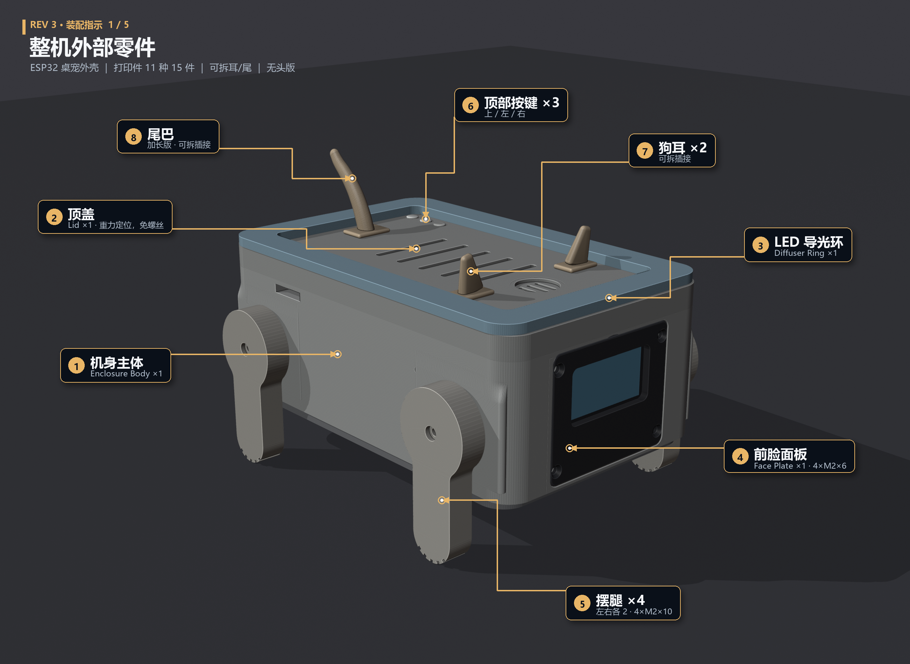
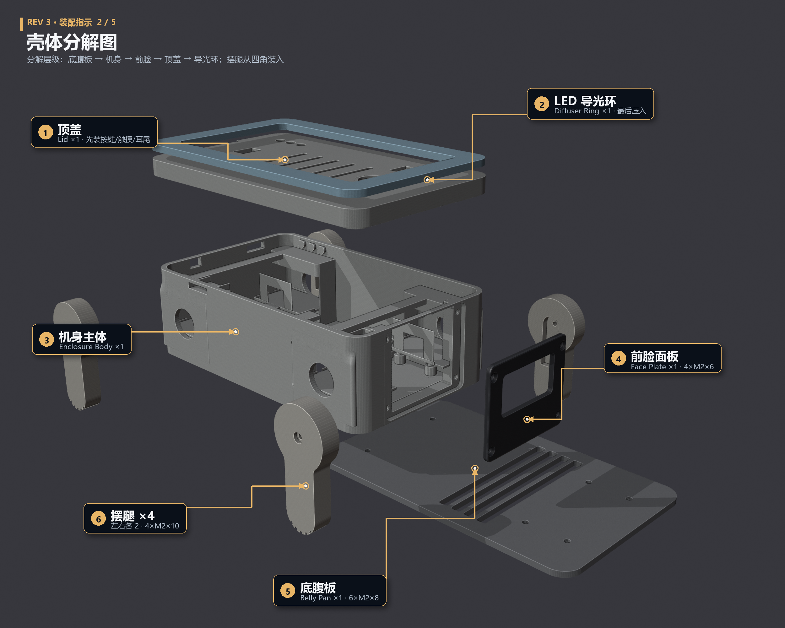
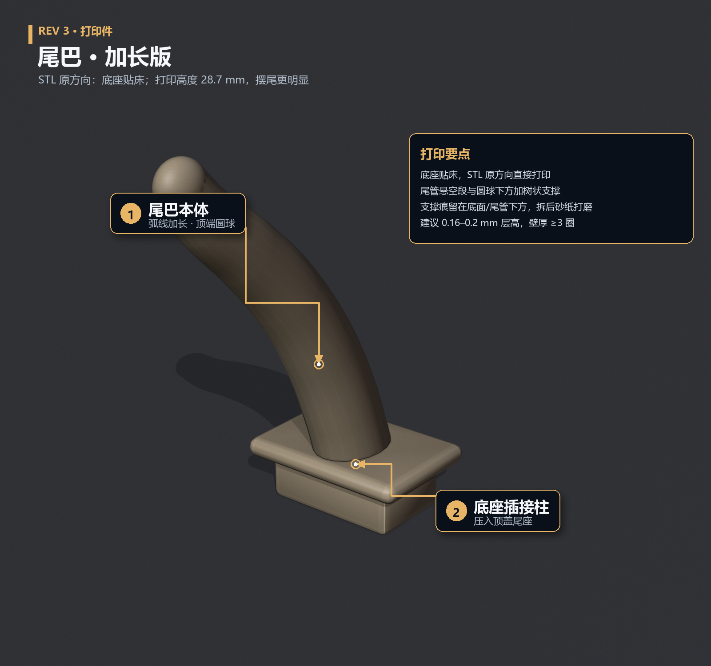
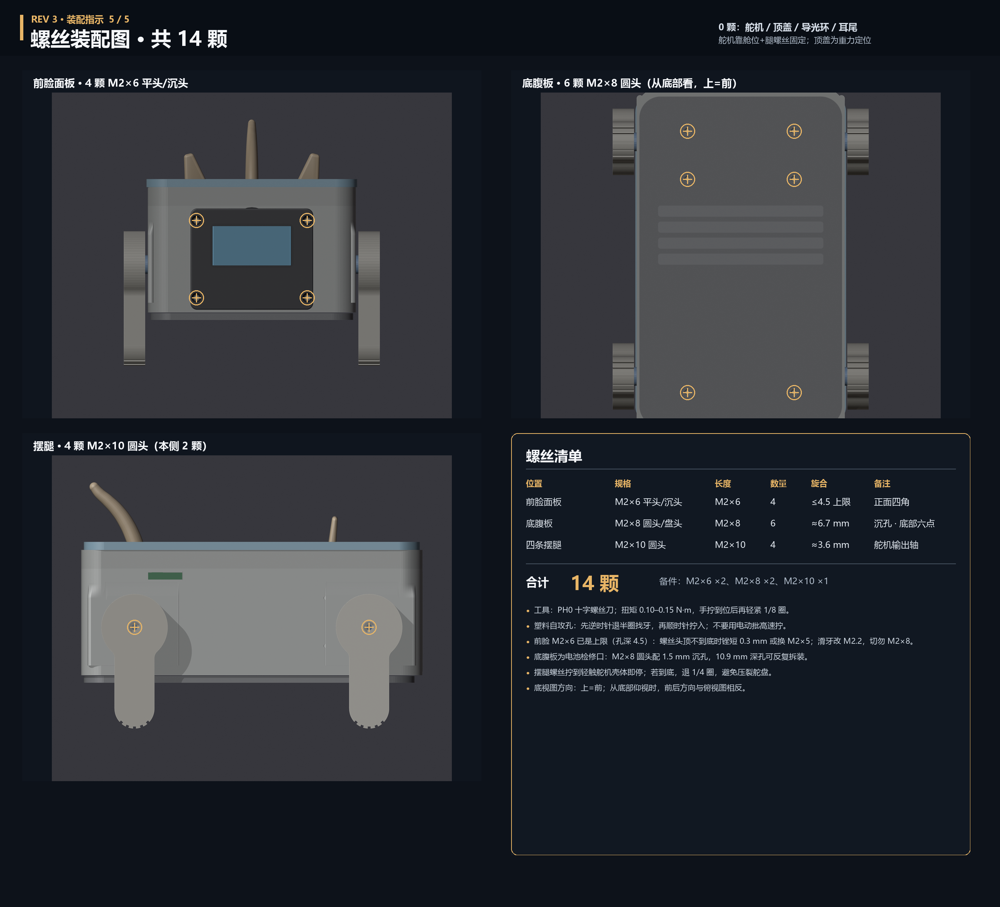
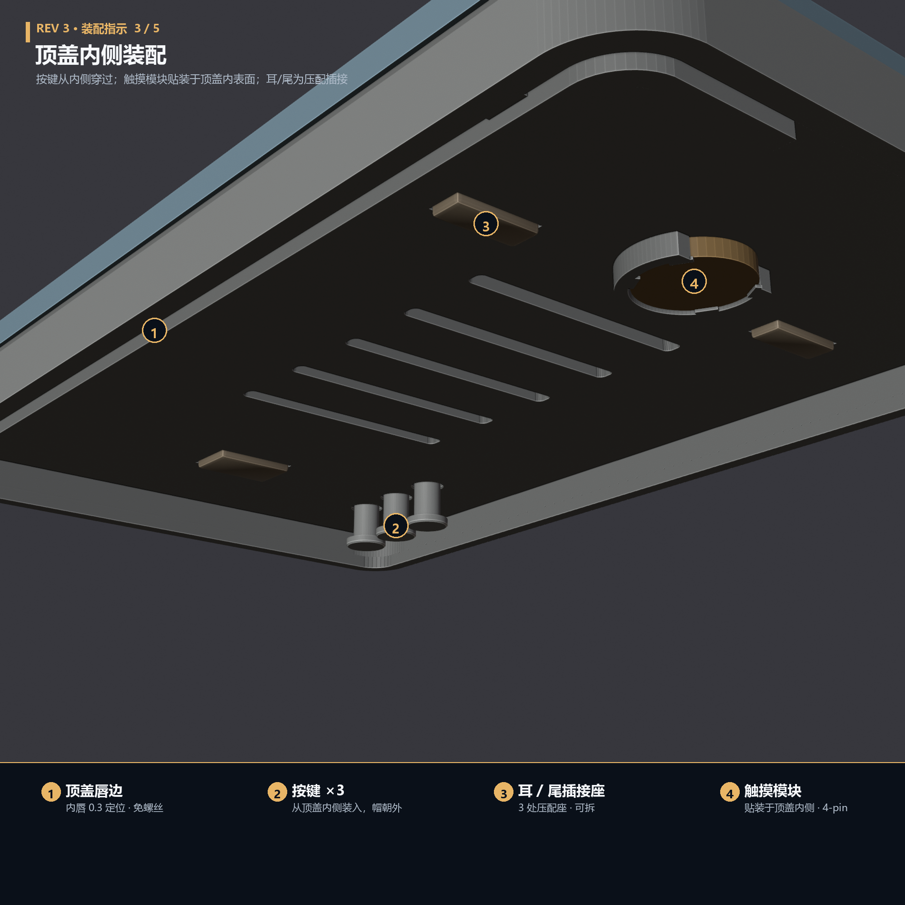
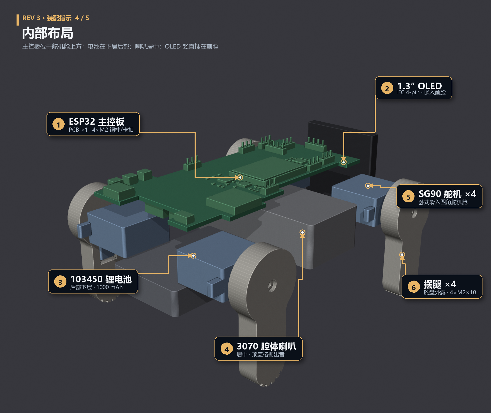

# 机器狗桌宠外壳 v3 装配指南

适用：`blender/robot_dog_enclosure_v3.blend`、`stl/v3/`  
更新：2026-11-12  
范围：无头壳版，顶盖 3 键 + 触摸栅格 + 可拆耳/尾 + 四条 SG90 摆腿 + 1.3″ OLED + 103450 电池 + 3070 喇叭。

> 本指南中的尺寸、间隙和干涉结果来自当前 Blender 场景与 STL 的数字化复测。**尚未做实物打印、跌落和长时间行走验证**；首件请按第 7 节先打小件试配。

## 1. 零件清单

共 **11 个 STL / 15 件打印件**，另有 **14 颗 M2 自攻螺丝**。

| 零件 | STL | 件数 | 外形 (mm) | 装配位置 / 备注 |
|---|---|---:|---|---|
| 机身主体 | `Enclosure_Body.stl` | 1 | 78.04×128×40 | z20–60；四角舵机舱、前脸嵌槽、底部 6 个螺丝柱 |
| 顶盖 | `Enclosure_Lid.stl` | 1 | 78×128×8.2 | z58.8–67；3 按钮孔、触摸 C 环、2 耳槽、1 尾槽 |
| 前脸面板 | `Face_Plate.stl` | 1 | 46×2.2×38 | z21–59；正面 y64.05，屏窗中心 z45 |
| 底腹板 | `Belly_Pan.stl` | 1 | 76×124×2.5 | z17.2–19.7；6 颗螺丝，电池检修口 |
| LED 导光环 | `LED_Diffuser_Ring.stl` | 1 | 79×126×3 | z67–70；最后压入顶盖 |
| 摆腿（左） | `Leg_L.stl` | 2 | 8×24.98×50.48 | z0–50.48；同一 STL 打印 2 件 |
| 摆腿（右） | `Leg_R.stl` | 2 | 8×24.98×50.48 | z0–50.48；同一 STL 打印 2 件 |
| 顶盖按钮 | `Button_Top.stl` | 3 | 5.6×5.6×8.85 | 帽顶 z67.75；从盖内侧装入 |
| 狗耳（左） | `Ear_L.stl` | 1 | 11.5×7.5×15.97 | 耳根 x=−21、y=30；耳尖 z79.69 |
| 狗耳（右） | `Ear_R.stl` | 1 | 11.5×7.5×15.97 | 耳根 x=+21、y=30；与左耳镜像 |
| 尾巴 | `Tail.stl` | 1 | 13×22.38×28.68 | 尾根 x0、y=−43；尾尖 z92.40 |

整机包络：**96×128.05×92.40 mm**（含四条腿、前脸、耳、尾；脚底 z0）。

## 2. 打印方向与支撑

下表方向按 STL 原始坐标给出；“>45° 悬垂面积”是当前网格的实测值，用于判断是否需要支撑，不等于必须全支撑。

| 零件 | 打印方向 | 实测床面 / >45° 悬垂 | 支撑与后处理 |
|---|---|---|---|
| 机身主体 | **底部朝下、开口朝上** | 5983.1 / 5375.3 mm² | 主要为内部 ledge 与舵机舱顶；在四个舵机舱、PCB 搁板下方加树状支撑，其余按切片预览 |
| 顶盖 | **外顶面朝下**（top-down） | 9261.7 / 846.4 mm² | 不加支撑；Ø4.4 按钮孔与灯环槽 3 mm 台阶可桥接 |
| 前脸面板 | **背面朝下** | 1187.5 / 0 mm² | 免支撑；沉头孔朝上 |
| 底腹板 | **外底面朝下** | 8238.0 / 68.5 mm² | 免支撑；喇叭槽桥接 |
| LED 导光环 | **平面朝下** | 1705.2 / 1945.5 mm² | 免支撑；1.4 mm 内部导光槽可桥接，首件检查槽顶塌陷 |
| 摆腿 ×4 | **外侧面朝下** | 841.8 / 10.0 mm² | 3–5 mm brim；0.16–0.2 mm 层高、4 圈壁 |
| 顶盖按钮 ×3 | **帽朝下** | 11.7 / 15.8 mm² | **必须加 brim**（床面接触仅 11.7 mm²）；帽为平滑球冠，免支撑 |
| 狗耳 ×2 | **舌/底座朝下** | 31.1 / 50.3 mm² | 建议 brim；法兰 1 mm 悬边可桥接 |
| 尾巴 | **底座朝下** | 60.9 / 47.3 mm² | **尾管悬空段与圆球下方加树状支撑**；拆后砂纸打磨接触点 |

材料建议：机身/顶盖/前脸/腹板/灯环/腿用 PETG 或 PLA+；耳/尾可 PETG，若需更大摩擦可 TPU 95A；按钮 PETG/PLA 均可。PLA 仅建议用于首件试装。

## 3. 螺丝清单与底孔

| 位置 | 数量 | 规格 | 头型 | 底孔 / 沉孔 | 有效旋合 | 备注 |
|---|---:|---|---|---|---|---|
| 前脸四角 | 4 | **M2×6 自攻** | 平头/沉头 | Ø1.7×4.5；沉头 Ø4.2×约 1.2 | ≤4.5（上限） | 正面 y64.05，孔位 x±20.8、z25.5/54.5 |
| 底腹板 | 6 | **M2×8 自攻** | 圆头/盘头 | Ø1.7×10.9；沉孔 Ø4.2×1.5 | ≈6.7 | x±20；y=48/30/−50；电池检修口 |
| 四条摆腿 | 4 | **M2×10 自攻** | 圆头/按钮头 | 腿通孔 Ø2.2；沉孔 Ø4.2×1.4 | ≈3.6 入舵机轴 | 轴心 y±44、z38；拧到轻触舵机壳即停 |

合计 **14 颗**。备件建议：M2×6 ×2、M2×8 ×2、M2×10 ×1。  
工具：PH0 十字螺丝刀；扭矩 **0.10–0.15 N·m**，手拧到位后再轻紧 1/8 圈。塑料自攻孔先逆时针退半圈找牙，再顺时针拧入，不要用电动批高速拧。

**前脸螺丝是长度上限，不要改长。** M2×6 的尖端已接近 Ø1.7×4.5 底孔底部；若螺丝头顶不到底，先把尖端锉短 0.3 mm 或改用 M2×5，不要硬拧。滑牙时换 M2.2 自攻或点少量胶，**切勿换 M2×8**。底腹板孔深 10.9 mm，M2×8 有约 6.7 mm 旋合，适合反复拆装。

## 4. 装配步骤

### 4.1 顶盖子装配（按钮 / 触摸 / 耳 / 尾）

1. 顶盖翻面，**外顶朝下、内侧朝上**。
2. 3 个按钮**帽朝下**从盖内侧送入 Ø4.4 孔；帽 Ø4.15 可自由穿过，法兰 Ø5.6 挂在盖内顶，倒置时不会掉出。位置 x=−24.83，y=−35.47/−42.45/−49.47。
3. 触摸模块 Ø11.8×1.98 从 C 形托环的 +Y 缺口（8 mm 深、13 mm 宽）滑入；模块顶面贴盖内顶，间隙 0.02；4 个小唇在底部托住，FPC 从缺口引出。
4. 耳/尾从顶盖**外侧**压入：
   - 耳舌 9.4×3.6 压入 9.6×3.8 槽（深 3.0），单边 0.10；左右耳镜像，不要装反。
   - 尾舌 10.2×6.4 压入 10.4×6.7 槽（深 3.0），X 单边 0.10、Y 单边 0.15。
   - 先对舌底 0.4–0.5 倒角，再均匀下压到法兰贴盖；不要用胶，首件试配后再决定是否加 0.1 mm 胶带。

### 4.2 舵机与摆腿

1. 4 个 SG90 卧式滑入四角舵机舱，输出轴从侧壁 Ø14 开口伸出；轴心 **y=±44、z=38**，本体 z31.9–44.1。
2. 先给舵机通电回中，再装单臂舵盘，臂朝下。
3. 腿内侧朝机身，舵盘臂插入 8.4 mm 宽 U 槽，轮毂落 R4.2 窝。
4. 从腿外侧沉孔拧入 **M2×10**；拧到轻触舵机壳体即停，若到底退 1/4 圈，避免压裂舵盘。
5. 手动摆 ±28°（建议步态 ±20°），确认腿不蹭机身、不蹭腹板，四脚能同时落地。

### 4.3 前脸与 OLED

1. 先在机身外组装前脸 + OLED：OLED 模块 35.4×33.5×5.0 从**前脸背面**推入屏仓，玻璃面朝外；模块玻璃/有效区前表面与面板背面留 **0.02**，不要压屏。
2. 在玻璃边缘 2 mm 以外点四点胶，或贴薄泡棉；胶不要盖住有效区。
3. 4-pin 软线先焊在 OLED 上，从机身前端开口穿入内腔，预留约 20 mm 线头；跨度约 **14.38 mm**，弯折半径 ≥3 mm，避开前脸 4 个螺丝沉头。
4. 前脸 46×2.2×38 压入机身 46.4×38.4×2.2 嵌槽，正面 y64.05，外凸 0.05。
5. 4 颗 **M2×6** 平头/沉头对角交替拧入，拧到头部与面板齐平；若头顶不到底，按第 3 节处理，不要加长螺丝。线头留在内腔，待第 4.4 节装 PCB 后焊到前缘。

### 4.4 主板 / 电池 / 喇叭

1. 主板 53.98×99.64×1.6 放在四角筋位，z54–55.6，板中心 y=−8，前缘 y41.82；底部贴泡棉，侧壁筋定位，无螺钉。把第 4.3 节预留的 OLED 4-pin 线焊到 PCB 前缘。
2. USB-C、电源开关、microSD 与机身开口对位；元件最高 60.44，顶盖内腔仍有余量。
3. 103450 电池（10×34×50，PH2.0）放入腹部电池仓 y−59.5…−8.5、z20.2–30.2；用 10 mm 魔术贴/双面胶固定，**先不要粘死**，整机装完测重心再定。
4. 3070 喇叭 30×70×18 放在腹部中央 y−7…23、z26–44，朝下出音；四周点胶 + 泡棉密封，避免腔体漏气。喇叭顶与主板下器件留约 5 mm 走线。
5. 所有线束避开四条腿的摆动区和前脸螺丝尖端。

### 4.5 底腹板

1. 腹板 76×124×2.5 对准机身底部 6 个螺丝柱；孔位前后不对称（y=48/30/−50），只有唯一正确方向。
2. 6 颗 **M2×8 圆头/盘头** 先全部轻拧，再对角交替拧紧；头部沉入 1.5 mm 沉孔。
3. 检查电池仓、喇叭栅格与四条腿的摆动净空；腹板与电池最小间隙 0.50。

### 4.6 合盖与导光环

1. 合盖前检查：OLED 顶部、4-pin 线、触摸 FPC 不被顶盖唇边压住；3 个按钮帽与 PCB 三个开关对位。
2. 顶盖为 **1.2 定位唇 + 约 0.2 外缘搭接，重力定位、不是摩擦锁扣**；内唇单边约 **0.30**，对位后从后向前平放到位即可，**顶盖不用螺丝**。若需搬运固定，可在止口贴 1 圈 0.2 mm 美纹胶，或加 2 颗 M2 侧向螺钉。
3. 按钮法兰与 PCB 开关留 0.10 预行程；帽顶高出盖面 0.75，按压 0.35 后由开关本体限位。
4. 最后压入 LED 导光环（z67–70）；环与耳/尾不接触，若过紧先修环内缘毛刺，不要强行压裂。
5. 拿起整机时托机身/腹板，不要拎耳、尾或按钮；不要只抓顶盖提整机（顶盖无锁扣，会脱开）。

### 4.7 功能测试

1. 逐个按 3 个顶盖按钮，确认触发清晰、回弹正常；必要时调整固件去抖。
2. 通过 3 条触摸缝测试触摸模块，确认灵敏度；不要扩缝。
3. 检查 OLED 显示、USB-C 供电/数据、电源开关、microSD 插拔。
4. 播放音频，确认喇叭无破音、腔体不漏气。
5. 四路舵机回中，装腿后先 ±15° 低频试走，再升到 ±20°；检查四脚着地、重心与耳/尾在震动下不松脱。
6. 连续快走 10 分钟摸舵机壳；若 >60°C，降频或加间歇。

## 5. 拆卸与维护

- **顶盖**：从侧缝插入塑料撬片，沿周边均匀上撬；不要拉耳/尾。
- **导光环**：从环外缘均匀上撬，避免单点受力。
- **耳/尾**：从法兰边缘垂直上拔；过紧用塑料撬片，不要掰鳍片或尾管。
- **前脸**：先拆 4 颗 M2×6，取出时托住 OLED，防止排线受力。
- **底腹板**：拆 6 颗 M2×8 即可换电池；复用同一规格，不要换更长螺丝。
- 自攻孔反复拆装后若变松，可点少量低强度螺纹胶或换 M2.2 自攻；不要用普通机螺丝强行攻入。

## 6. 验证记录（数字化）

### 6.1 装配干涉

对 14 对关键配合做 EXACT 布尔交集，体积均为 **0.0000 mm³**：

`Lid×Body`、`Face_Plate×Body`、`Belly_Pan×Body`、`Ring×Lid`、`Tail×Lid`、`Ear_L×Lid`、`Ear_R×Lid`、`Button_1/2/3×Lid`、`Touch_Module×Lid`、`PCB×Body`、`Battery×Body`、`Speaker×Body`。

> 2026-11-12 修复：机身内壁原有两个残留筋条与顶盖唇边重叠 **2.73 mm³**；已用布尔差集切除，切除后 `Lid×Body` 交集为 0。修复前备份：`blender/_work/robot_dog_enclosure_v3_pre_lidfix.blend`。

### 6.2 关键间距（mm）

| 配合 | 实测 |
|---|---:|
| 尾 ↔ 灯环 | 5.496 |
| 尾 ↔ 机身 | 11.041 |
| 右耳 ↔ 灯环 | 2.749 |
| 左耳 ↔ 灯环 | 2.745 |
| 耳 ↔ 触摸模块 | 9.928 |
| 触摸模块 ↔ 顶盖 | 0.020 |
| 按钮 ↔ PCB 元件 | 0.100 |
| 前脸 ↔ OLED 有效区 | 0.020 |
| 腹板 ↔ 电池 | 0.500 |
| 顶盖唇边 ↔ 机身内壁（单边） | ≈0.304 |

### 6.3 STL 审计

11 个 STL 全部为单一连通体，**非流形边 0、边界边 0、零面积面 0**。三角面数与体积：

| STL | 三角面 | 体积 (mm³) |
|---|---:|---:|
| Enclosure_Body | 46 624 | 76 556.0 |
| Enclosure_Lid | 8 582 | 27 869.6 |
| Face_Plate | 2 008 | 2 615.6 |
| Belly_Pan | 1 552 | 20 663.5 |
| LED_Diffuser_Ring | 1 420 | 8 228.4 |
| Leg_L / Leg_R | 2 624 / 个 | 6 246.1 / 条 |
| Button_Top | 4 032 / 个 | 106.5 / 个 |
| Ear_L / Ear_R | 582 / 只 | 379.9 / 只 |
| Tail | 7 432 | 847.9 |

整机包络 **96×128.05×92.40**；尾尖 92.40，耳尖 79.69，腿顶 50.48，灯环顶 70.00。

## 7. 首件试装与风险

1. **先打小件**：1 只耳 + 尾 + 3 按钮 + 顶盖，试 0.10/0.15 压配和按钮回弹；再打前脸 + 1 条腿试 OLED/舵盘；最后打机身/腹板/灯环。
2. **FDM 孔会缩**：0.10 单边配合可能变过盈；过紧砂纸修舌侧，过松贴 0.1 mm 胶带，不要修槽到松垮。
3. **前脸螺丝**：M2×6 已是上限；头顶不到底时锉短尖端或换 M2×5；滑牙用 M2.2 或胶，不要用 M2×8。
4. **OLED 批次**：按 35.4×33.5×5.0、有效区 29.42×14.70 设计；来料偏厚/偏大会顶盖或塞不进屏仓，首件干装。
5. **触摸模块批次**：按 Ø11.8×1.98 设计，径向仅 0.2、顶部仅 0.02；来料偏差会塞不进或顶盖。
6. **舵盘批次**：按臂长 18、厚 2.5、宽 7.2 设计；臂长 >18 剪短，厚 >2.5 锉薄；M2×10 顶到舵机壳时退 1/4 圈或换 M2×8 + 垫片。
7. **电池保护板**：103450 带保护板可能超厚；先干放，压带可放松，不要强压。
8. **尾管支撑痕**：支撑接触点会留痕；拆后砂纸打磨，不要用尾管提整机。
9. **摩擦配合不是锁扣**：耳/尾/按钮靠摩擦/卡装；桌面展示可行，儿童/宠物环境建议加胶带、TPU 或小螺钉。
10. **顶盖为重力定位**：内唇单边约 0.30、外缘仅约 0.2 搭接，不产生摩擦保持力；搬动托底，倒置或只抓顶盖会脱开。需要搬运固定时贴 1 圈 0.2 mm 美纹胶或加 2 颗 M2 侧向螺钉，不要靠加大唇边硬压。
11. **热与安全**：ESP32 + 4 舵机同时工作会温升；保持顶盖 5 条散热槽和喇叭栅格畅通。未做实物跌落、充电温升和儿童安全验证，小件远离 3 岁以下儿童和宠物。

## 8. 文件索引

- 装配场景：`blender/robot_dog_enclosure_v3.blend`（`RobotDog_v3` / `Print_Masters` / `Fit_Check`）
- 打印文件：`stl/v3/`（11 个 STL，1:1 mm）
- 设计文档：`design/enclosure-v3.md`
- 基线细节：`design/enclosure-v2.md`
- 标注图：`design/enclosure-v3-parts-overview.png`、`-exploded-labeled.png`、`-lid-labeled.png`、`-internal-labeled.png`、`-screws.png`、`-tail-print.png`
- 复测脚本：`blender/_work/rev15_boolint.py`、`rev15_dist.py`、`rev15_pilots.py`、`rev15_panholes.py`、`rev15_overhang.py`、`rev15_overhang_detail.py`、`rev16_metrics.py`、`rev16_stl_numbers.py`

---

**结论**：当前模型在数字层面可完整装配：15 件打印件、14 颗螺丝，14 对关键配合 0 干涉，11 个 STL 网格无缺陷。前脸 M2×6 是长度上限，尾巴必须加支撑、按钮必须加 brim，顶盖必须外顶面朝下打印。实物首件仍需按第 7 节试配。
