# 机器狗桌宠外壳 v3：顶盖三键 + 可拆狗耳/尾 + 触摸栅格

更新：2026-11-12（装配复测、尾巴加长、螺丝优化）  
基础：`blender/robot_dog_enclosure_v3.blend`（在 v2 基线 `robot_dog_enclosure_v2.blend` 上增补）  
渲染：`blender/_review/` 30–48；模型预览见 `enclosure-v3-preview.png`  
装配指南：`design/enclosure-v3-assembly.md`（零件、螺丝 BOM、打印方向、逐步装配）

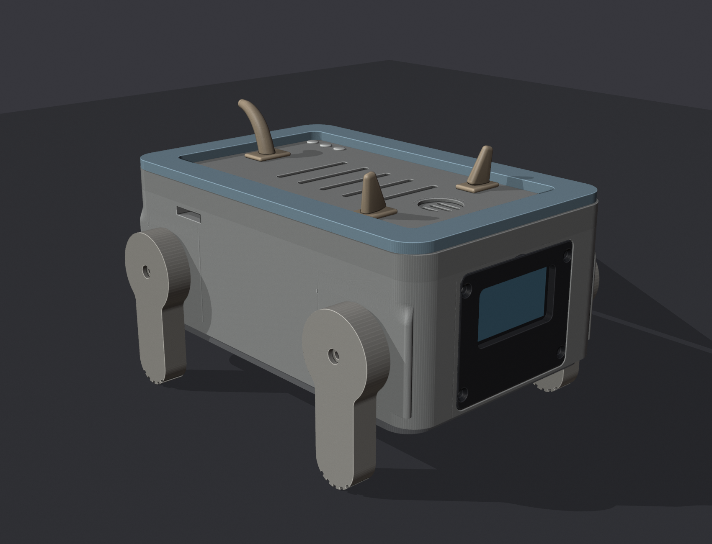

> **2026-11-12 修订**：3 个顶盖按钮的外露触摸面由“4 瓣开槽帽”改为**整体平滑球冠 Ø4.15**；顶盖对应改为 **Ø4.4 直通孔**，旧 Ø4.9×0.3 浅座填平齐平；按压限位改由 PCB 开关本体承担，法兰 Ø5.6 继续防脱。顶盖/机身在 Blender 内按 BEAUTY 三角化后，11 个 STL 均为 **0 非流形 / 0 边界 / 0 零面积**。新增 42–48 内部结构图。
>
> **2026-11-12 装配复测**：切除机身内壁两个与顶盖唇边重叠的残留筋条（2.73 mm³），14 对关键配合 EXACT 布尔交集全部为 **0**；尾长增至 **28.68 mm**、尾尖 **92.40**；前脸/腹板螺丝规格复测为 **4×M2×6 平头 + 6×M2×8 圆头 + 4×M2×10 圆头 = 14 颗**；新增 6 张箭头标注图与 `enclosure-v3-assembly.md`。**顶盖配合表述修正**：实测内唇单边约 0.30、外缘仅约 0.2 搭接，为重力定位而非摩擦锁扣；图 1/3/5 与三份文档已统一。

## 0. 本次修订

| 项目 | v2 | v3 |
|---|---|---|
| 交互按键 | 3 个侧壁按键柱（−X 左壁） | **3 个顶盖按钮**，移到顶盖后左，正对 PCB 同 3 个开关；侧壁旧孔填平 |
| 触摸 | 顶盖 Ø12 圆孔 + Ø15.5 沉台 | **Ø13 浅指窝 + 3 条 1.2×8.2 触摸缝**，下置 C 形托环，保留 Ø11.8 模块 |
| 头部 | 无头壳 | 顶盖前部 **2 只可拆狗耳**，左右镜像，压入燕尾舌/槽 |
| 尾部 | 无 | 顶盖后中 **1 条可拆上翘尾巴**，曲线管 + 球头，压入舌/槽 |
| 整机高度 | 70 | **92.40**（尾尖最高），耳尖 79.69；X/Y 包络不变 96×128.05 |
| 打印件 | 10 STL / 12 件 | **11 STL / 15 件**（新增 3 顶盖按钮、2 耳、1 尾；删除 3 侧键） |
| 紧固件 | M2×14 | **仍 14 颗**：4×M2×6 平头（前脸）+ 6×M2×8 圆头（腹板）+ 4×M2×10 圆头（腿）；耳/尾/按钮免螺钉 |

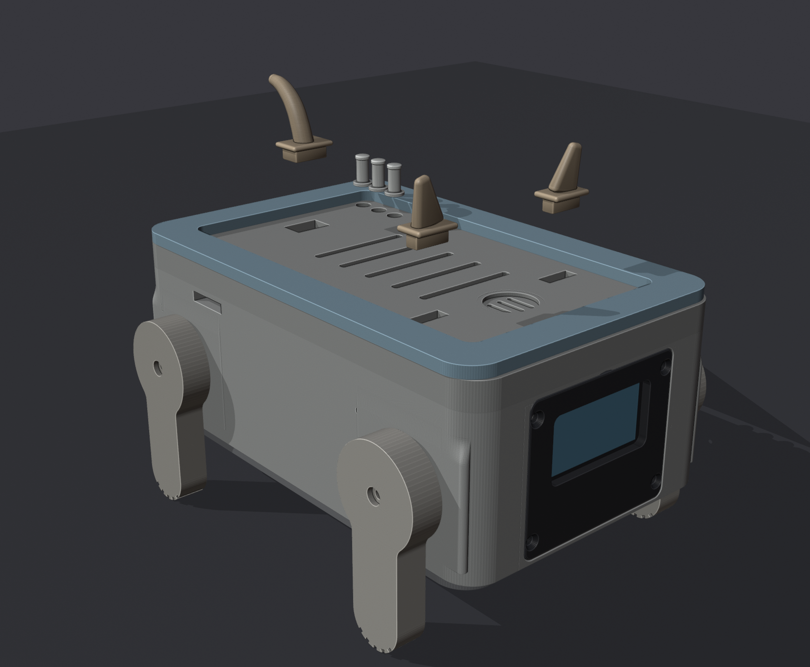

## 1. 顶盖三按钮（平滑触摸面）

### 1.1 位置与尺寸

- 3 个按钮中心：**x=−24.83，y=−35.47 / −42.45 / −49.47**，与 PCB 上原有 3 个开关同轴；间距 6.98。
- 按钮总成 5.6×5.6×8.85：法兰 Ø5.6×1.0（z58.9–59.9，杆根 R0.3 过渡）、杆 Ø3.6（z59.8–66.5）、帽 Ø4.15（z66.5–67.75）。帽顶是 **0.40 高的平滑椭球冠**，与圆柱帽壁连续过渡，**外露触摸面与侧面无槽、无拼缝**。
- 装配后帽顶高出顶盖 **0.75**；帽下段 **0.5** 伸入 Ø4.4 孔（单边 **0.125**），上段 0.75 露出。法兰底面 58.9 与开关顶 58.8 留 **0.10**；按压行程 **0.35**（开关全行程）后由**开关本体**限位，此时帽顶仍高出盖面 0.40。
- 顶盖孔：**Ø4.4 直通孔**（z64.6–67.0，盖厚 2.4）；旧 Ø4.9×0.3 浅座已用同材质圆柱填平、顶面与盖面齐平（67.0）；孔口为直角（打印后轻修毛刺即可），无内侧导锥。
- 防脱：法兰 Ø5.6 > 孔 Ø4.4，**无法从外侧拔出**；手动上提约 5.7 到盖内顶 64.6 时由法兰限位。旧版“4 瓣帽压缩过孔”的装配方式，由平滑帽直接穿过 Ø4.4 孔取代。

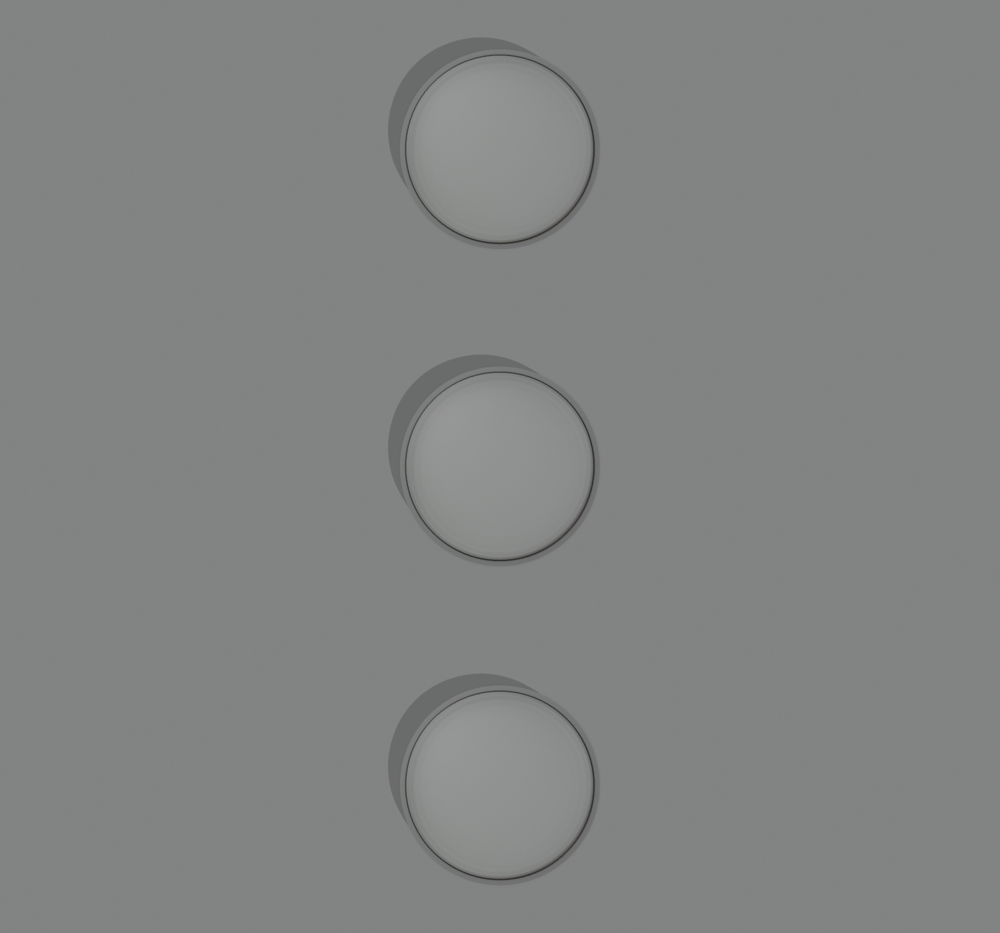
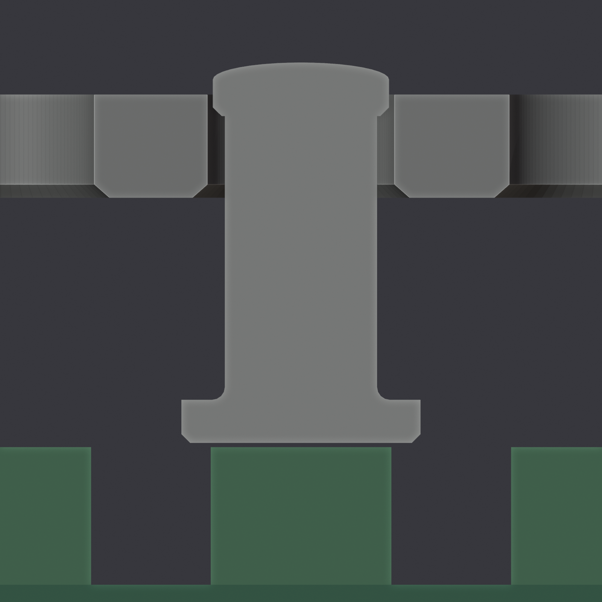

### 1.2 装配与手感

1. 顶盖翻面（外顶朝下），把按钮**帽朝下**从盖内侧送入 Ø4.4 孔；帽 Ø4.15 可自由穿过，法兰 Ø5.6 挂在盖内顶，倒置时按钮不会掉出。
2. 装触摸模块/耳/尾后合盖，任选其一：
   - **先放按钮**：把 3 个按钮法兰坐到 PCB 开关上，再把顶盖的 3 个 Ø4.4 孔对准帽缓缓放下，孔会套住帽；轻压确认触发与回弹。
   - **先装盖**：翻回顶盖时用平整卡片/手掌压住 3 个露出的帽，扣到位后抽出卡片；按钮由开关从下方托住（0.10 预行程）。
3. 顶盖单独拿开时，按钮通常留在机身开关上；若随盖带走再翻面，按钮可能向内掉落，属正常现象，按上面任一方式重装即可。
4. 不建议扩孔：孔径每大 0.1，帽周缝隙更明显；首件过紧时用圆锉轻修孔口毛刺，不要修帽。

## 2. 触摸栅格与 C 形托环

- 顶盖顶面做 **Ø13×1.0 浅指窝**（中心 x0、y35），窝底开 **3 条 1.2×8.2 缝**（x=−3.2/0/+3.2，端部 R0.6），缝底即模块顶面。
- 模块仍为 Ø11.8×1.98，装配后 z62.60–64.58，顶面与盖内顶 64.6 留 **0.02**；C 形托环 OD14.8 / ID12.2、高 2.65（z62.25–64.9），单边径向间隙 **0.2**。
- 托环在 +Y 开 8 mm 深、13 mm 宽的缺口，模块从前方滑入；环底 4 个 0.6×2.2×0.3 的小唇（30°/150°/210°/330°）托住模块底，模块底部与唇顶留 0.05，顶部与盖留 0.02，轴向总游隙 0.07。
- 3 条缝取代原来的 Ø12 大孔：手指定位更明确，碎屑/灰尘进入面积更小；触摸时通过缝直接接触模块，不需要按压盖板。

## 3. 可拆狗耳

### 3.1 造型与尺寸

- 单只 11.5×7.5×15.97；鳍片 8.5×3.0，根部到顶 12，顶部收成 40%×70% 的圆角尖，整体外倾 **14°**、后仰 **6°**，边缘 R1.15 圆角。
- 底部：11.5×7.5×1.4 的贴合法兰 + 9.4×3.6×3.4 的燕尾舌；舌底 0.4 倒角作导入。
- 左右耳为镜像网格（`Ear_L` 由 `Ear_R` 镜像并重算法线），外观对称；耳根中心 x=±21、y=30，耳尖 z79.69。

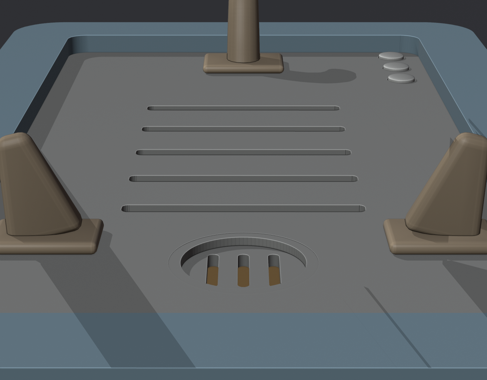
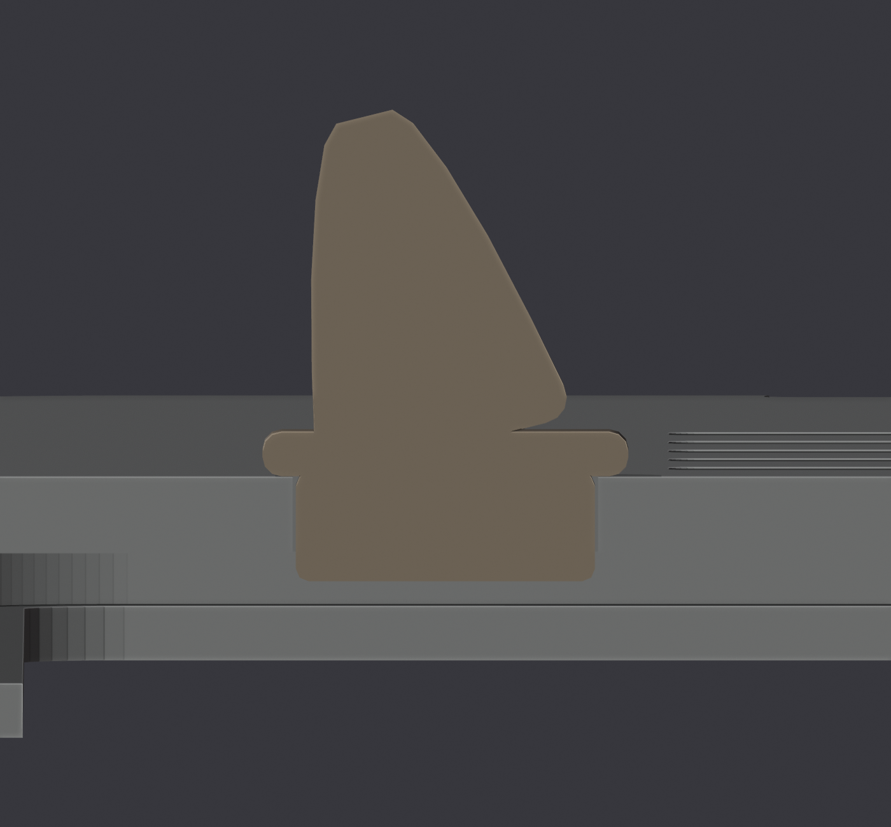

### 3.2 可拆配合

| 项目 | 数值 |
|---|---|
| 顶盖耳槽 | 9.6×3.8，深 3.0（z64.2–67.2） |
| 耳舌 | 9.4×3.6×3.4 |
| 单边间隙 | **0.10**（X/Y 相同），总间隙 0.20 |
| 法兰与盖面 | 0.02 |
| 舌底伸出盖内顶 | 0.88（z63.72） |
| 固定方式 | 摩擦压配，无螺钉；从上方压入/拔出 |

- 舌的直段在 z64.12 以上，正好进入槽深 3.0 的直壁；0.4 倒角先导入，压到底时法兰贴盖。
- **不是卡扣**：耳/尾靠摩擦保持，适合桌面展示；不要拎着耳朵/尾巴搬整机。若需儿童/宠物环境，建议在舌侧加 0.1 mm 双面胶或改 TPU 95A 打印（摩擦更大、可弯）。

## 4. 可拆上翘尾巴

### 4.1 造型与尺寸

- 单条 13×22.38×28.68；贴合法兰 13×9×1.4，燕尾舌 10.2×6.4×3.4（底 0.5 倒角）。
- 曲线管从法兰根部向后上方翘起，根部 Ø5.4 渐缩到端部 Ø3.1，端部 R1.55 球头；曲线在 y/z 平面内单调上升，无自交，尾尖 z92.40。
- 装配后尾尖高出顶盖 **25.40**，但仍在机身 Y 包络内（最远 y−60.88，机身后缘 −64），不增加 footprint。
- 尾管最低点与灯环最近 **5.50**（在 y≈−53、z≈67.7 处），与机身最近 **11.04**；抬头/搬动不会碰环。

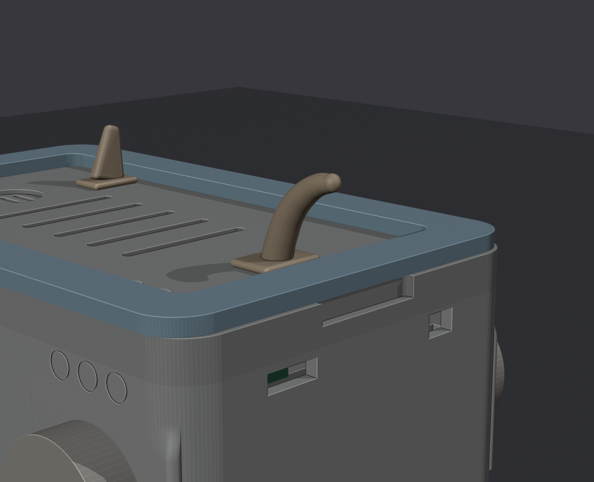
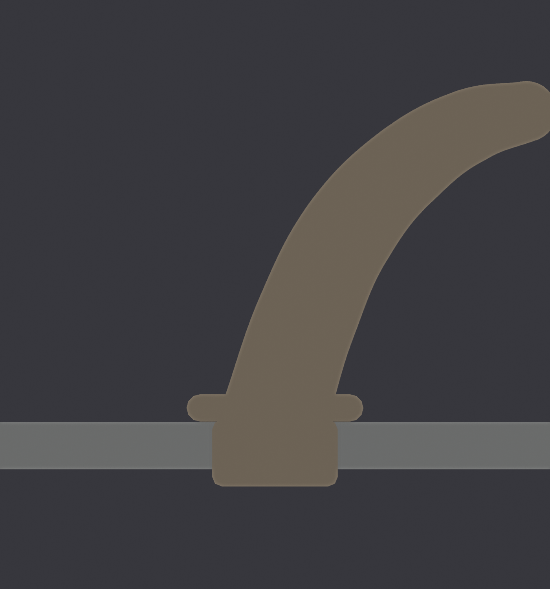

### 4.2 可拆配合

| 项目 | 数值 |
|---|---|
| 顶盖尾槽 | 10.4×6.7，深 3.0（z64.2–67.2） |
| 尾舌 | 10.2×6.4×3.4 |
| 单边间隙 | X **0.10**、Y **0.15** |
| 法兰与盖面 | 0.02 |
| 固定方式 | 摩擦压配，无螺钉 |

- 尾舌比耳舌宽，Y 向留 0.15，压入时略松于耳；若首件偏松，可在舌侧面贴一层 0.1 mm 胶带，或在切片里把尾舌 X/Y 放大 0.5%。
- 尾管是悬臂，打印时**必须加支撑**托住管下缘（尤其尾尖球头）；不要用尾管当提手。

## 5. 顶盖与侧壁改动

- 顶盖仍 78×128×8.2（z58.8–67），**1.2 定位唇 + 约 0.2 外缘搭接，重力定位、非摩擦锁扣**（内唇单边约 0.30；搬动托底，灯环压住外圈）；新增 3 个 **Ø4.4 按钮直通孔**（旧 Ø4.9×0.3 浅座已填平、顶面齐平）、2 个耳槽、1 个尾槽、Ø13 指窝 + 3 缝、C 形托环。
- 原 Ø12 触摸大孔用 r8 圆片补平（顶面 66.98，比盖面低 0.02），再在其上做指窝/缝；旧孔不再裸露。
- 侧壁 3 个旧按键孔用 Ø4.3×3.55 圆柱从内侧填平；外壁经射线检查为连续实体（x=−39 处法线 −X），侧面无孔/无凹坑。
- 旧侧键柱 `Button_Plunger_1/2/3` 已删除；PCB 上 3 个开关保留，由顶盖按钮从上方按压。
- 灯环、顶盖、前脸、机身、腿、腹板、OLED、电池、SD 等 v2 结构不变。

## 6. 验证结果（2026-11-11，v3 场景/STL）

### 6.1 干涉与间距

- 本轮对 14 对关键配合做 EXACT 布尔交集，**全部 0.0000 mm³**：Lid×Body、Face_Plate×Body、Belly_Pan×Body、Ring×Lid、Tail×Lid、Ear_L/R×Lid、Button_1/2/3×Lid、Touch_Module×Lid、PCB×Body、Battery×Body、Speaker×Body；此前 29 对快速干涉检查亦为 0 面重叠。
- **顶盖唇边干涉已修复**：机身内壁 y≈−50/−35 处两个残留筋条与顶盖唇边重叠 **2.73 mm³**；布尔差集切除后 Lid×Body 交集为 0，唇边与机身内壁单边间隙 **≈0.304**。修复前备份 `blender/_work/robot_dog_enclosure_v3_pre_lidfix.blend`。
- 关键间距：
  - 按钮法兰 ↔ PCB 开关：**0.100**（3 个一致）。
  - 耳 ↔ 灯环：**2.749 / 2.745**；耳 ↔ 触摸模块：**9.928**。
  - 尾 ↔ 灯环：**5.496**；尾 ↔ 机身：**11.041**。
  - 触摸模块 ↔ 顶盖：**0.020**；前脸 ↔ OLED 有效区：**0.020**。
  - 腹板 ↔ 电池：**0.500**；顶盖唇边 ↔ 机身内壁：**≈0.304**。
- 耳/尾/按钮/顶盖均为单一连通体，非流形边 0；触摸模块顶部与 3 条缝对位，C 环单边 0.2。
- 平滑帽 Ø4.15 与 Ø4.4 孔单边 **0.125**；帽下段入孔 0.5，静止时按钮与顶盖 **0 面重叠**，与开关 0.10。

### 6.2 STL 审计（`stl/v3/`，11 个文件）

| STL | 件数 | 尺寸 (mm) | 连通体 | 非流形边 | 边界边 | 零面积面 | 体积 (mm³) |
|---|---|---|---|---|---|---|---|
| Enclosure_Body | 1 | 78.04×128×40 | 1 | 0 | 0 | 0 | 76 556 |
| Enclosure_Lid | 1 | 78×128×8.2 | 1 | 0 | 0 | 0 | 27 870 |
| Face_Plate | 1 | 46×2.2×38 | 1 | 0 | 0 | 0 | 2 616 |
| Belly_Pan | 1 | 76×124×2.5 | 1 | 0 | 0 | 0 | 20 664 |
| LED_Diffuser_Ring | 1 | 79×126×3 | 1 | 0 | 0 | 0 | 8 228 |
| Leg_L / Leg_R | 各 2 | 8×24.98×50.48 | 1 | 0 | 0 | 0 | 6 246 / 条 |
| Button_Top | 3 | 5.6×5.6×8.85 | 1 | 0 | 0 | 0 | 106 / 个 |
| Ear_R / Ear_L | 各 1 | 11.5×7.5×15.97 | 1 | 0 | 0 | 0 | 380 / 只 |
| Tail | 1 | 13×22.38×28.68 | 1 | 0 | 0 | 0 | 847.9 |

- 11/11 文件单连通，**非流形边 0、边界边 0、零面积面 0**。为保证 STL 干净，顶盖/机身已在源文件中按 BEAUTY 方式三角化（顶盖 8 582 面、机身 46 624 面，与 STL 面数一致）；其余零件保持原始拓扑。
- 整机包络 **96×128.05×92.40**；耳尖 79.69，尾尖 92.40；腿顶 50.48、灯环顶 70 保持不变。
- 装配件合计 **15 件**：机身 1、顶盖 1、前脸 1、腹板 1、灯环 1、腿 4、顶盖按钮 3、耳 2、尾 1。

## 7. 打印清单与方向

| STL | 件数 | 打印方向 | 支撑/注意 |
|---|---|---|---|
| Enclosure_Body | 1 | **底部朝下、开口朝上** | 舵机舱、PCB 搁板下方加树状支撑；实测床面 5983 / >45° 5375 mm²，按切片预览取舍 |
| Enclosure_Lid | 1 | **外顶面朝下（top-down）** | **不要顶面朝上**（内部大顶面会产生约 9437 mm² 悬垂）；实测床面 9262 / >45° 846 mm²，Ø4.4 孔与 3 mm 灯环槽可桥接，免支撑 |
| Face_Plate | 1 | **背面朝下** | 沉头孔朝上；实测 >45° 为 0 |
| Belly_Pan | 1 | **外底面朝下** | 喇叭槽桥接；实测 >45° 68.5 mm² |
| LED_Diffuser_Ring | 1 | **平面朝下** | 1.4 mm 导光槽可桥接；实测 >45° 1945.5 mm² 属内部槽 |
| Leg_L / Leg_R | 各 2 | **外侧面朝下** | 大平面贴床，3–5 mm brim；0.16–0.2 层高，4 圈壁；>45° 10 mm² |
| Button_Top | 3 | **帽朝下** | **必须加 brim**（床面仅 11.7 mm²）；帽为平滑球冠、无槽，免支撑 |
| Ear_R / Ear_L | 各 1 | **舌/底座朝下** | 建议 brim（床面 31.1 mm²）；法兰 1 mm 悬边可桥接；鳍片外倾 14°，一般免支撑 |
| Tail | 1 | **底座朝下** | **尾管悬空段与圆球下方必须加树状支撑**；床面 60.9 / >45° 47.3 mm²；拆除时护住 Ø3.1 尾端 |

- 材料：外壳/顶盖/耳/尾 PETG 或 PLA+；按钮 PETG/PLA 均可（TPU 95A 会增加摩擦，但帽与孔间隙/按压手感会变）。腿仍建议 PETG/PLA+。
- 耳/尾若用 TPU 95A，舌的 0.1 间隙会更容易压入且不易断；但 TPU 表面摩擦大，拔出时慢一点。
- 紧固件：**4×M2×6 平头/沉头（前脸）+ 6×M2×8 圆头/盘头（腹板）+ 4×M2×10 圆头（腿轴）= 14 颗**；M2×6 是前脸孔深上限，头顶不到底时锉短 0.3 mm 或换 M2×5，滑牙改 M2.2，**切勿用 M2×8**。腹板 M2×8 有效旋合约 6.7 mm，适合电池检修反复拆装。耳/尾/按钮免螺钉。

## 8. 装配顺序

详细逐步装配、螺丝 BOM、打印方向与首件试配见 **`design/enclosure-v3-assembly.md`**。概要：

1. **顶盖子装配**：顶盖翻面（外顶朝下），3 个按钮帽朝下从内侧装入 Ø4.4 孔，法兰挂在盖内顶；触摸模块从 C 环 +Y 缺口滑入，顶面贴盖内顶（0.02）；耳/尾从外侧对准舌槽垂直压入到法兰贴盖。
2. **舵机与腿**：4×SG90 卧式入四角舱，输出轴穿侧壁 Ø14；先通电回中再装单臂舵盘，臂朝下；腿 U 槽套舵盘、轮毂落 R4.2 窝，M2×10 从外侧沉孔拧入，轻触舵机壳即停；手动摆 ±28°（建议 ±20°）查干涉。
3. **前脸与 OLED**：先在机外把 OLED 从背面推入前脸屏仓，玻璃朝外，有效区与面板背留 0.02；玻璃边缘 2 mm 外点四点胶；4-pin 线焊好后从机身前端开口穿入，前脸压入机身嵌槽，4×M2×6 对角交替拧平；装 PCB 后再把线焊到前缘（跨度约 14.38）。
4. **主板 / 电池 / 喇叭**：PCB 放 z54–55.6 四角筋位，底部泡棉；电池入腹部仓，先不粘死；喇叭朝下，四周点胶 + 泡棉密封；线束避开腿摆动区和螺丝尖端。
5. **腹板**：6×M2×8 圆头按唯一方向对位（y=48/30/−50），先全部轻拧，再对角拧紧。
6. **合盖与灯环**：检查 OLED 顶、触摸 FPC、4-pin 线不被顶盖唇边压住；3 个按钮帽对准 PCB 开关，顶盖对位后从后向前平放到位（重力定位，不靠摩擦）；最后压入导光环。
7. **功能测试**：3 按钮触发/回弹、触摸灵敏度、OLED、USB/开关/SD、喇叭、四舵机中位与 ±20° 步态；连续快走 10 分钟摸舵机壳温。
8. 搬整机时托机身/腹板，不要拎耳、尾或按钮。

## 9. 风险与待确认

1. **摩擦配合不是锁扣**：耳/尾/按钮帽都靠摩擦/卡装；倒置或甩动可能掉耳/尾。桌面展示没问题，儿童/宠物场景建议加 0.1 mm 胶带、TPU 或小螺钉。
2. **FDM 孔缩小**：0.1 单边间隙在 FDM 上可能变成过盈；首件先打 1 只耳 + 尾，试槽；过紧砂纸修舌侧，过松贴胶带，不要修槽到松垮。
3. **按钮防脱/装配**：法兰 Ø5.6 > Ø4.4 孔，装好后无法从外侧拔出；但顶盖单独拿开时按钮只由下方开关托住，翻面可能向内掉落，按第 8 节顺序装配即可。帽与孔单边 0.125，若首件偏紧先修孔口毛刺，不要扩孔。
4. **触摸模块批次**：Ø11.8×1.98 是常见尺寸；来料更厚/更大会顶住盖或塞不进 C 环（径向仅 0.2、顶部仅 0.02）。首件干装确认。
5. **尾管打印**：悬臂 + 球头，支撑接触点会留痕；建议支撑只在管下缘，拆后砂纸修。不要用尾管提整机。
6. **高度**：尾尖 92.40，比 v2 高 22.40；确认展示架/包装高度。耳尖 79.69。
7. **灯环净空**：尾管与灯环最近 5.50；耳与灯环 2.75；装灯环/顶盖时先对尾/耳位置，避免压到环。
8. **侧壁旧孔**：已用 Ø4.3 柱填平，外壁连续；若打印后看到轻微环印，砂纸/补土处理，不影响强度。
9. **STL 三角化**：顶盖/机身已在源文件内按 BEAUTY 三角化，11 个 STL 均 0 非流形/0 边界/0 零面积；后续若再改孔/布尔，需重新三角化并跑 `rev3_stl_audit.py`。
10. **未做实物/跌落/儿童安全验证**：耳/尾/按钮为小件，远离 3 岁以下儿童和宠物；PLA 脆，最终件建议 PETG。
11. **顶盖按钮映射**：仍使用 PCB 原 3 个开关，GPIO 不变；固件无需改引脚，但按键方向由“侧按”变“顶按”，手感/去抖参数建议重调。
12. **触摸栅格**：3 条缝总开口约 29.5 mm²，比 Ø12 孔小很多；若实测灵敏度下降，优先减薄盖厚/调阈值，不要扩缝到破坏指窝。
13. **前脸螺丝长度上限**：M2×6 已接近 Ø1.7×4.5 底孔底部；螺丝头顶不到底时先锉短尖端 0.3 mm 或换 M2×5，滑牙改 M2.2 或点胶，**切勿用 M2×8**。底腹板 M2×8 孔深 10.9、有效旋合约 6.7，适合反复拆装。
14. **顶盖为重力定位，不是锁扣**：内唇单边约 0.30、外缘仅约 0.2 搭接，不产生摩擦保持力；靠自重 + 导光环压住。搬整机必须托底，倒置/甩动顶盖可能脱落；需要更牢时在止口贴 1 圈 0.2 mm 美纹胶，或加 2 颗 M2 侧向螺钉，不要靠加大唇边硬压。

## 10. 内部结构与源文件

内部结构图（2026-11-12 新增）：

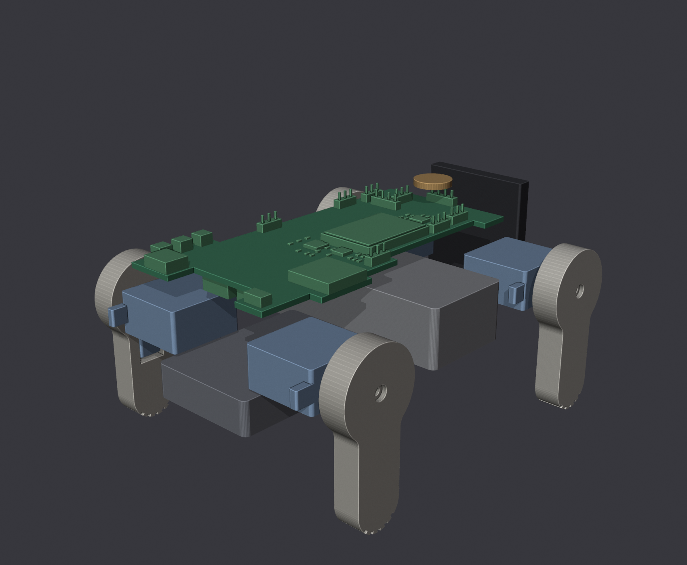
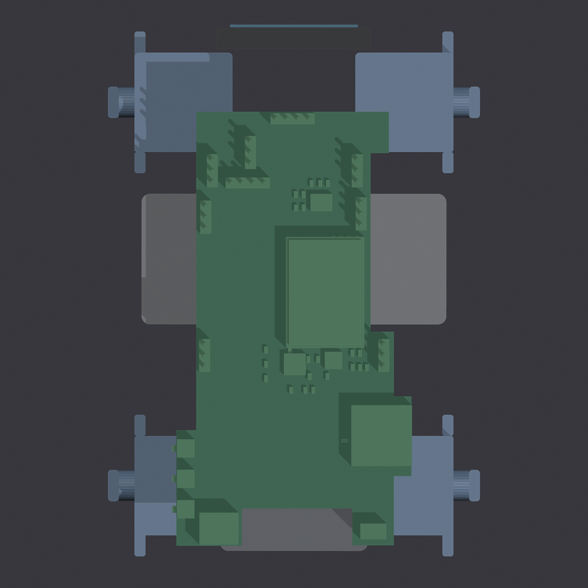
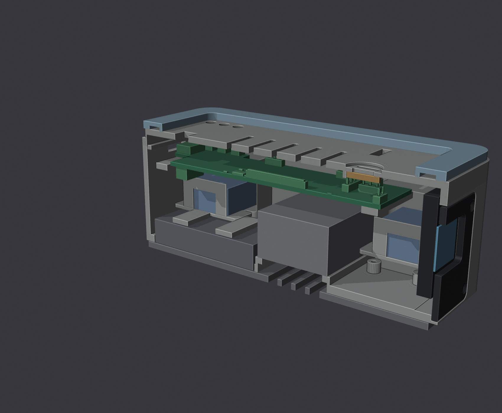
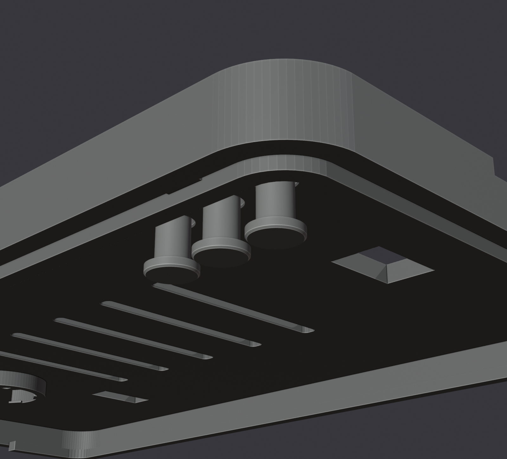
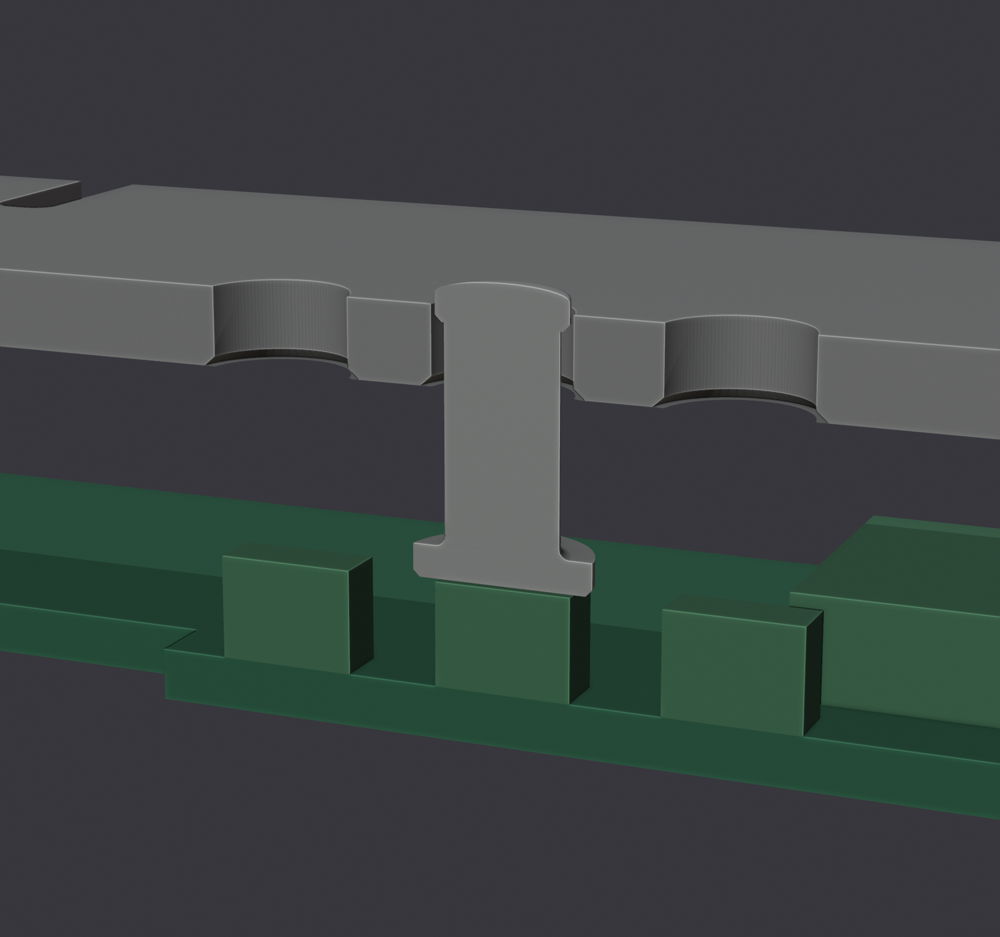

装配标注图（2026-11-12 新增，详见 `design/enclosure-v3-assembly.md`）：

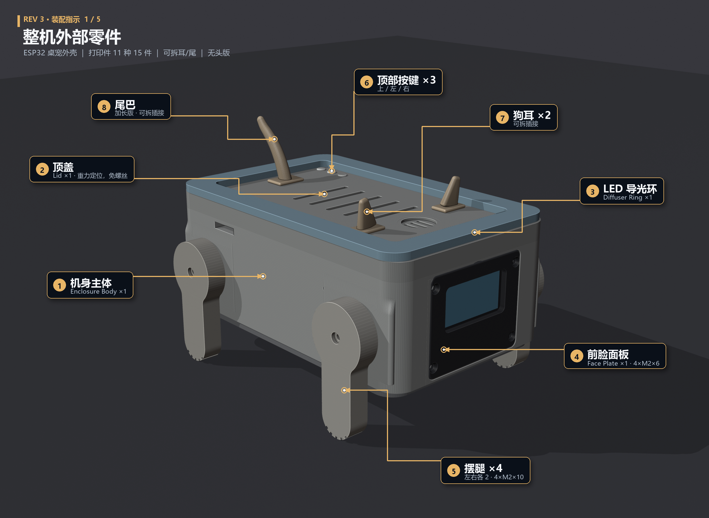
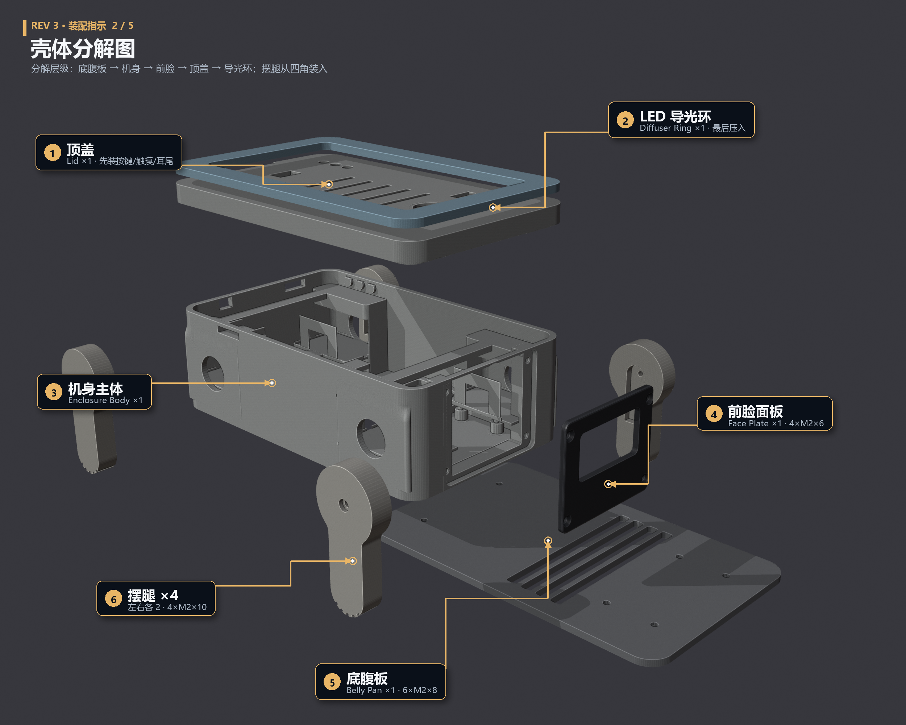
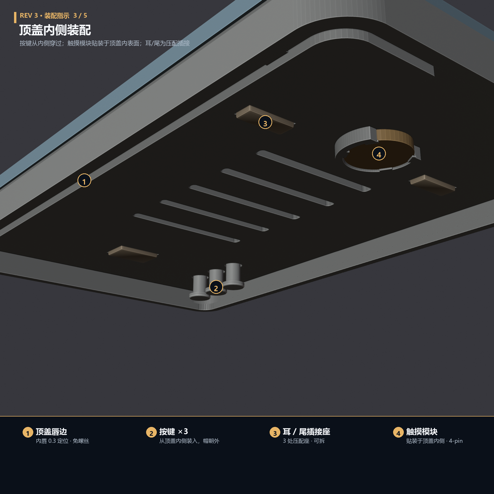
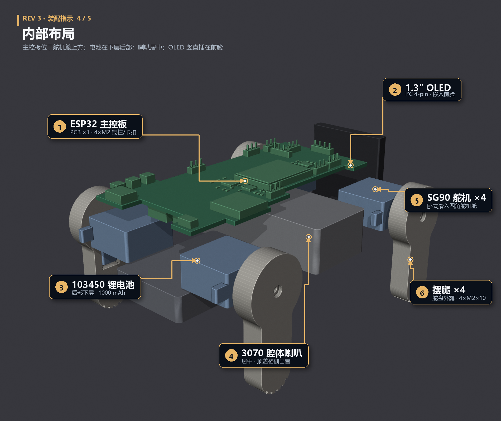
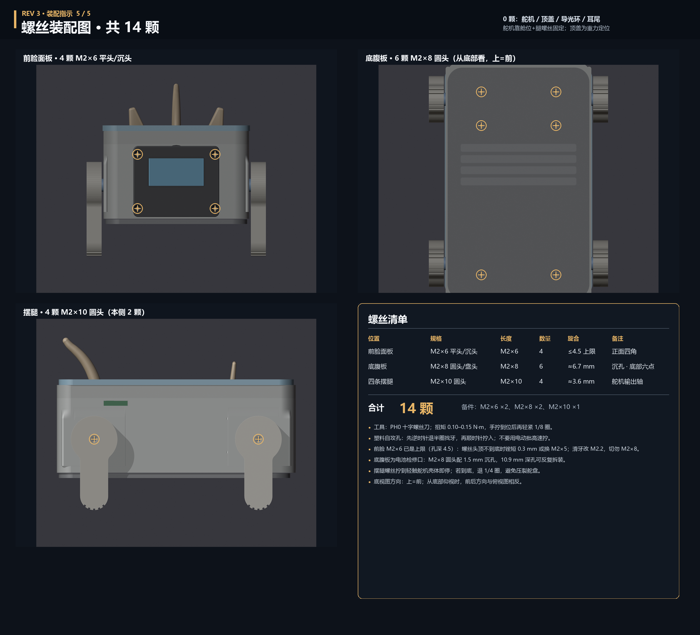
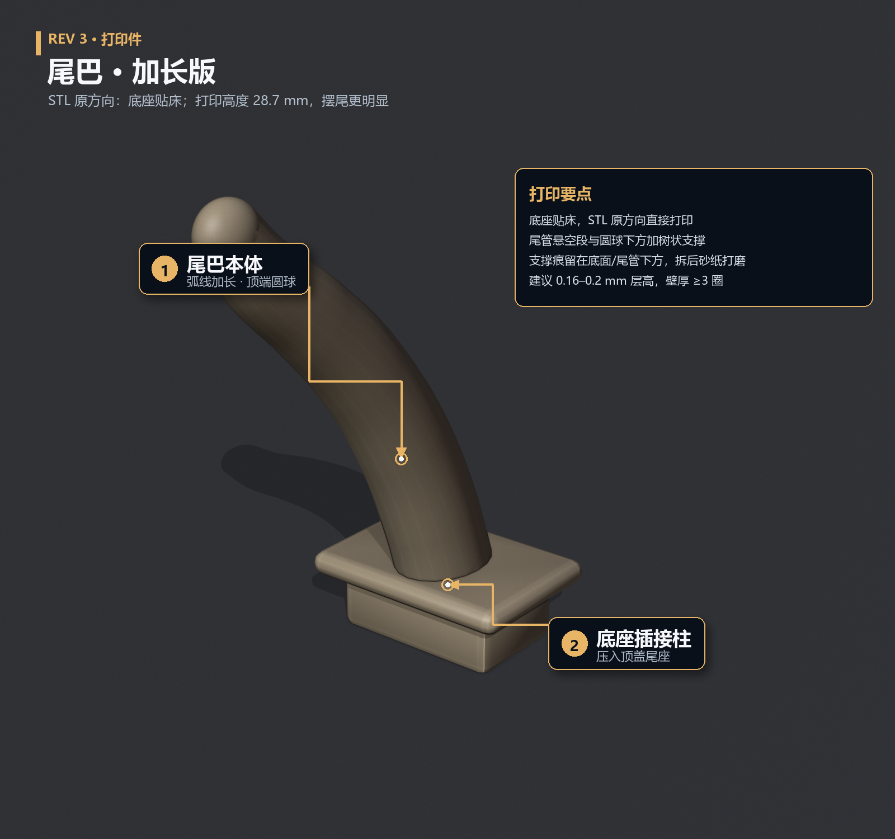

- 主场景：`blender/robot_dog_enclosure_v3.blend`（集合 `RobotDog_v3`；打印母件在 `Print_Masters`；检具在 `Fit_Check`）
- STL：`stl/v3/` 11 个文件 / 15 件
- 渲染：`blender/_review/30_rev3_hero.png` … `48_int_button_section_34.png`；本文件用图已复制到 `design/enclosure-v3-*.png`
- 建模/验证脚本：`blender/_work/rev3_build.py`、`rev3_addons.py`、`rev3_validate.py`、`rev3_renders.py`、`rev3_export.py`、`rev3_stl_audit.py`；`rev13_build.py`、`rev13_promote.py`、`rev13_lidtri_apply.py`、`rev13_renders.py`；本轮复测 `rev15_lidfix.py`、`rev15_boolint.py`、`rev15_dist.py`、`rev15_pilots.py`、`rev15_panholes.py`、`rev15_overhang.py`、`rev15_overhang_detail.py`、`rev16_metrics.py`、`rev16_stl_numbers.py`
- 基线文档：`design/enclosure-v2.md`（腿/OLED/电池/端口/SD/腹板等 v2 细节）
- 装配指南：`design/enclosure-v3-assembly.md`（零件清单、螺丝 BOM、打印方向、逐步装配、拆卸、验证）
- 上一版 STL：`stl/v2/`（保留，v3 已替换机身/顶盖并新增 4 类零件）
